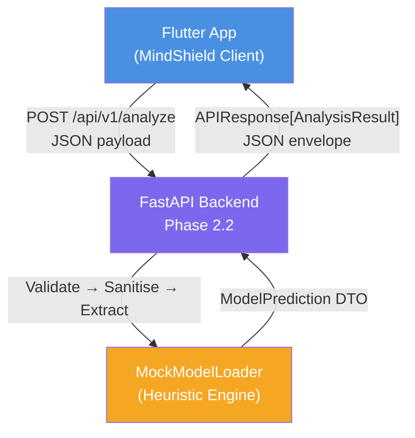
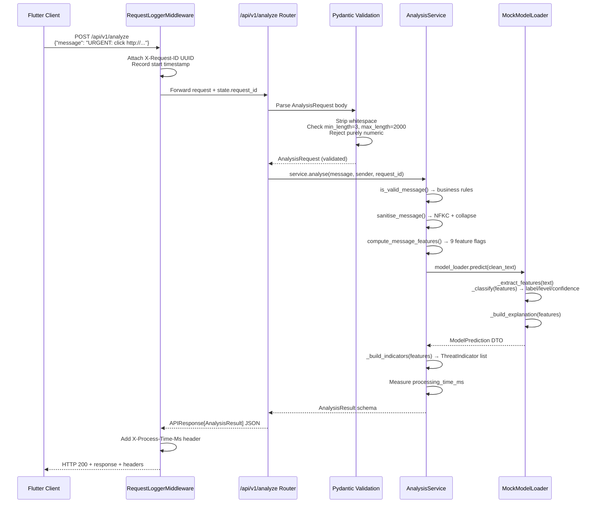
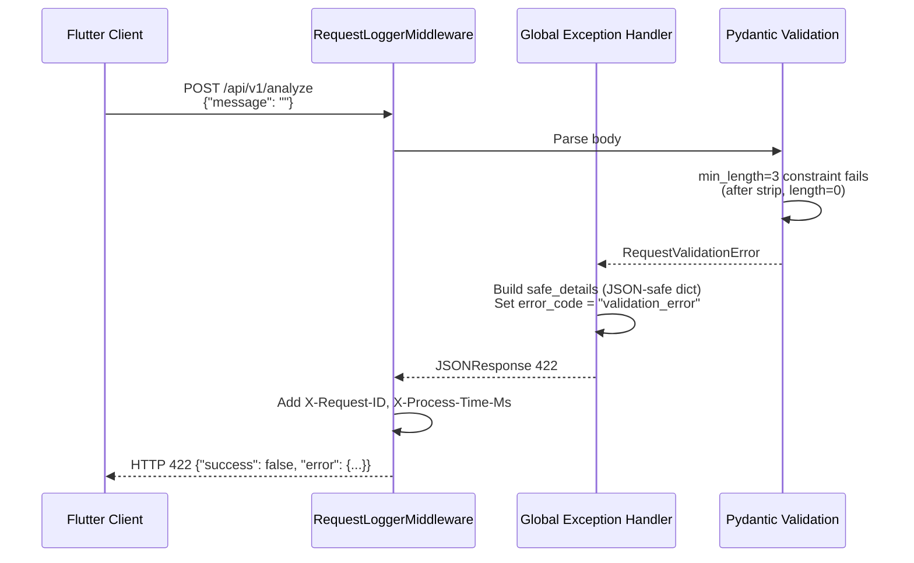
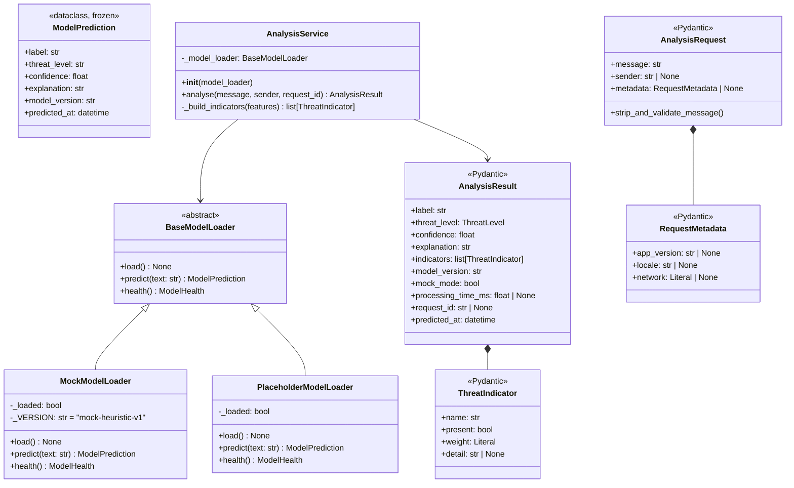
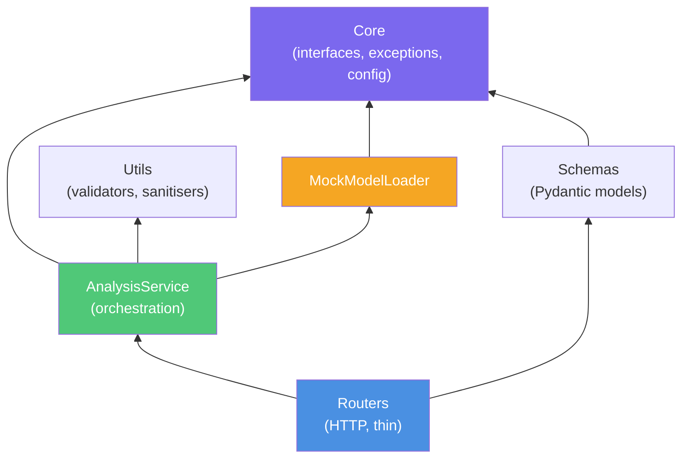
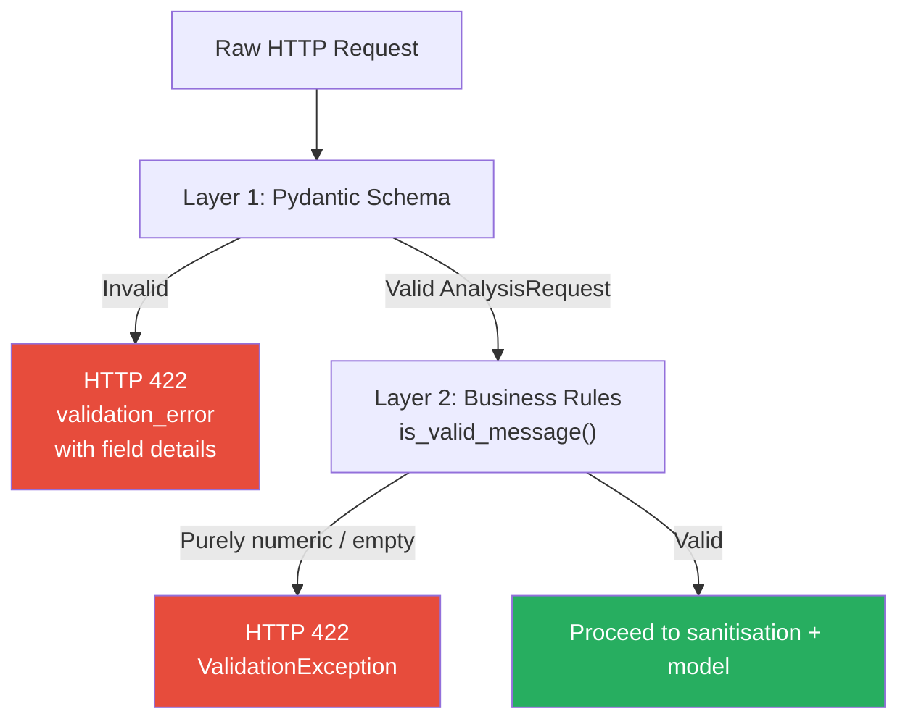
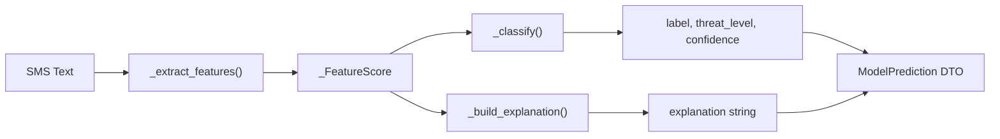
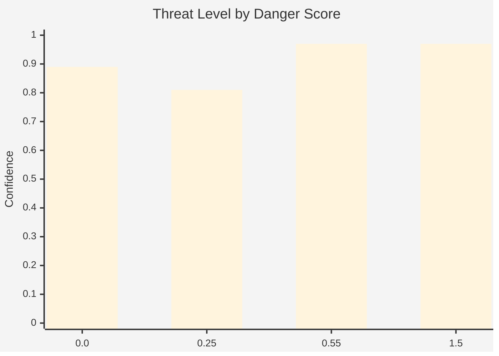

# MindShield Backend — Phase 2.2: API Layer Architecture
### Thesis-Ready Technical Reference

> **Project**: MindShield — AI-Powered SMS Cybersecurity Application  
> **Module**: Phase 2.2 — REST API Layer with Mock Analysis Engine  
> **Stack**: Python 3.13 · FastAPI 0.115 · Pydantic v2 · Uvicorn · pytest  
> **Author**: Junaid Ahmed | Final Year Project | University of Sindh | 2026  
> **Date**: 3 August 2026

---

## Table of Contents

1. [Executive Summary](#1-executive-summary)
2. [System Context](#2-system-context)
3. [Request–Response Flow](#3-requestresponse-flow)
4. [Component Architecture](#4-component-architecture)
5. [API Endpoint Documentation](#5-api-endpoint-documentation)
6. [Request Schema Design](#6-request-schema-design)
7. [Response Schema Design](#7-response-schema-design)
8. [Validation Strategy](#8-validation-strategy)
9. [Mock Analysis Engine](#9-mock-analysis-engine)
10. [Heuristic Classification Logic](#10-heuristic-classification-logic)
11. [OpenAPI / Swagger Documentation](#11-openapi--swagger-documentation)
12. [Middleware Pipeline](#12-middleware-pipeline)
13. [Error Response Catalogue](#13-error-response-catalogue)
14. [Verification Results](#14-verification-results)
15. [Assumptions & Constraints](#15-assumptions--constraints)
16. [Implementation Decisions & Trade-offs](#16-implementation-decisions--trade-offs)
17. [Limitations](#17-limitations)
18. [Future Enhancements (Phase 2.3+)](#18-future-enhancements-phase-23)

---

## 1. Executive Summary

Phase 2.2 extends the Phase 2.1 API foundation by introducing a **realistic mock analysis engine** and a **fully-documented REST API layer**. The core deliverable is the `POST /api/v1/analyze` endpoint — the primary interface between the MindShield Flutter client and the backend classification pipeline.

In this phase, SMS classification is performed by the `MockModelLoader`, a deterministic heuristic engine that analyses message text using rule-based signals (URLs, urgency language, credential requests, financial keywords) to produce varied, contextually appropriate responses across the full threat spectrum. This enables full-stack integration testing and Flutter UI development without requiring a trained NLP model.

**Key Phase 2.2 deliverables**:

| Deliverable | Status |
|-------------|--------|
| `POST /api/v1/analyze` with mock responses | ✅ Complete |
| `ThreatIndicator` per-signal transparency | ✅ Complete |
| `RequestMetadata` client context block | ✅ Complete |
| Full OpenAPI / Swagger documentation | ✅ Complete |
| Multiple request/response examples | ✅ Complete |
| Heuristic classification engine | ✅ Complete |
| 132 automated tests, 93% coverage | ✅ Complete |
| Flake8 lint: zero violations | ✅ Complete |

---

## 2. System Context

### 2.1 Position in Architecture



### 2.2 Phase Boundary

Phase 2.2 is strictly bounded by:
- **IN**: HTTP request handling, input validation, heuristic classification, JSON response construction.
- **OUT**: Real NLP/ML inference (Phase 2.3), database persistence (Phase 2.4), authentication (Phase 2.5).

---

## 3. Request–Response Flow

### 3.1 Sequence Diagram — Successful Analysis



### 3.2 Sequence Diagram — Validation Failure



### 3.3 End-to-End Processing Timeline

```mermaid
gantt
    title Request Processing Timeline (typical ~3–10 ms)
    dateFormat  x
    axisFormat  %L ms

    section Middleware
    Attach UUID + timestamp      :0, 1
    CORS check                   :1, 2

    section Validation
    Pydantic parse               :2, 3
    Field validators             :3, 4

    section Service
    Business rule validation     :4, 5
    Sanitisation (NFKC)         :5, 6
    Feature extraction           :6, 7

    section MockModel
    Heuristic classification     :7, 8
    Explanation construction     :8, 9

    section Serialisation
    Indicator list build         :9, 10
    JSON serialisation           :10, 11
```



---

## 4. Component Architecture

### 4.1 Class Diagram



### 4.2 Layer Dependencies



**Dependency Rule**: Dependencies always point inward (toward Core). Core has zero outward dependencies.

---

## 5. API Endpoint Documentation

### 5.1 Endpoint Summary

| Method | Path | Description | Auth |
|--------|------|-------------|------|
| `POST` | `/api/v1/analyze` | Classify an SMS message | None (Phase 2.2) |
| `GET` | `/api/v1/analyze/status` | API v1 operational status | None |
| `GET` | `/health` | Application health check | None |

### 5.2 POST /api/v1/analyze

#### Request

```
POST /api/v1/analyze HTTP/1.1
Host: localhost:8000
Content-Type: application/json
```

**Request Body**:

| Field | Type | Required | Constraints | Description |
|-------|------|----------|-------------|-------------|
| `message` | `string` | ✅ Yes | 3–2000 chars, not purely numeric | Raw SMS body text to classify |
| `sender` | `string \| null` | ❌ No | ≤50 chars | Phone number or display name |
| `metadata` | `object \| null` | ❌ No | — | Client context (app_version, locale, network) |
| `metadata.app_version` | `string \| null` | ❌ No | ≤20 chars | MindShield app version (e.g. "1.0.0") |
| `metadata.locale` | `string \| null` | ❌ No | ≤10 chars | BCP-47 locale (e.g. "en-GB") |
| `metadata.network` | `"wifi" \| "mobile" \| "unknown" \| null` | ❌ No | Enum | Connectivity type |

#### Response (200 OK)

| Field | Type | Description |
|-------|------|-------------|
| `data.label` | `string` | Raw classifier label (`safe`, `phishing`, `suspicious`) |
| `data.threat_level` | `"safe" \| "suspicious" \| "dangerous"` | Normalised severity |
| `data.confidence` | `float [0.0–1.0]` | Classification confidence |
| `data.explanation` | `string` | Human-readable rationale |
| `data.indicators` | `ThreatIndicator[]` | Per-signal evidence list |
| `data.model_version` | `string` | Active model/engine version |
| `data.mock_mode` | `bool` | True when using mock engine |
| `data.processing_time_ms` | `float \| null` | Server classification time (ms) |
| `data.request_id` | `string \| null` | UUID for log correlation |
| `data.predicted_at` | `datetime` | UTC inference timestamp |

#### Example: Dangerous SMS (Phishing)

**Request**:
```json
{
  "message": "URGENT: Your Lloyds Bank account has been suspended. Verify immediately: http://lloydssecure.example.com",
  "sender": "LLOYDS",
  "metadata": {"app_version": "1.0.0", "locale": "en-GB", "network": "mobile"}
}
```

**Response**:
```json
{
  "success": true,
  "message": "Analysis complete",
  "data": {
    "label": "phishing",
    "threat_level": "dangerous",
    "confidence": 0.94,
    "explanation": "⚠️ HIGH THREAT — contains a URL or shortened link; uses urgency/imperative language; references financial institutions or transactions. [Mock heuristic — not a real AI prediction]",
    "indicators": [
      {"name": "credential_request", "present": false, "weight": "critical", "detail": null},
      {"name": "url_detected",       "present": true,  "weight": "high",     "detail": "Suspicious URL detected in message body"},
      {"name": "urgency_language",   "present": true,  "weight": "high",     "detail": "Urgency/imperative language detected"},
      {"name": "financial_keywords", "present": true,  "weight": "medium",   "detail": "References financial institutions or transactions"},
      {"name": "prize_language",     "present": false, "weight": "medium",   "detail": null},
      {"name": "excessive_caps",     "present": false, "weight": "low",      "detail": null}
    ],
    "model_version": "mock-heuristic-v1",
    "mock_mode": true,
    "processing_time_ms": 2.41,
    "request_id": "a1b2c3d4-e5f6-7890-abcd-ef1234567890",
    "predicted_at": "2026-08-03T21:00:00Z"
  },
  "error": null,
  "timestamp": "2026-08-03T21:00:00Z"
}
```

#### Example: Safe SMS

**Request**: `{"message": "Hi! Are you coming to lunch tomorrow?"}`

**Response** (abbreviated):
```json
{
  "success": true,
  "data": {
    "label": "safe",
    "threat_level": "safe",
    "confidence": 0.89,
    "explanation": "✅ LOW RISK — uses casual, friendly language. [Mock heuristic]",
    "indicators": [...all 6 indicators with present=false except safe signals...],
    "mock_mode": true,
    "processing_time_ms": 1.83
  }
}
```

---

## 6. Request Schema Design

### 6.1 AnalysisRequest

```python
class AnalysisRequest(BaseModel):
    message: str       # 3–2000 chars, not purely numeric
    sender:  str | None = None
    metadata: RequestMetadata | None = None
```

### 6.2 Validation Layers

The request passes through **two distinct validation layers** before reaching the service:

```
Layer 1: Pydantic Schema Validation  →  HTTP 422 on failure
Layer 2: Business-Rule Validation    →  HTTP 400/422 on failure
```

| Layer | Mechanism | Example Rejection |
|-------|-----------|-------------------|
| Pydantic | `min_length=3` on `message` | Empty string → 422 |
| Pydantic | `max_length=2000` on `message` | 2001-char string → 422 |
| Pydantic | `field_validator` | Non-string → 422 |
| Business | `is_valid_message()` | Purely numeric string → 422 |
| Business | `model_health.is_loaded` | Model not ready → 503 |

### 6.3 Field Validator: `strip_and_validate_message`

```python
@field_validator("message", mode="before")
@classmethod
def strip_and_validate_message(cls, v: str) -> str:
    if not isinstance(v, str):
        raise ValueError("message must be a string")
    return v.strip()   # strip BEFORE min_length check
```

The `mode="before"` ensures whitespace stripping runs *before* Pydantic's `min_length` constraint, so `"   "` (3+ chars but whitespace-only) correctly fails with length 0 after stripping.

---

## 7. Response Schema Design

### 7.1 APIResponse[T] — Generic Envelope

All endpoints share the same outer structure, enabling the Flutter Dio client to use a single generic deserialisation function:

```dart
// Flutter Dart
class ApiResponse<T> {
  final bool success;
  final String message;
  final T? data;
  final ErrorDetail? error;
  final String timestamp;
}
```

### 7.2 ThreatIndicator

The `indicators` list provides **per-signal transparency**, differentiating the mock engine from a black-box system:

```python
class ThreatIndicator(BaseModel):
    name:    str                                    # e.g. "url_detected"
    present: bool                                   # True if detected
    weight:  Literal["critical","high","medium","low"]
    detail:  str | None                             # Human annotation
```

All 6 indicators are always included in the response — both `present=True` and `present=False` — enabling the Flutter UI to display the complete evidence panel.

### 7.3 Threat Level Mapping

```
danger_score ≥ 0.55  →  "dangerous"  (confidence: 0.82–0.97)
danger_score ≥ 0.25  →  "suspicious" (confidence: 0.65–0.81)
danger_score <  0.25 →  "safe"       (confidence: 0.60–0.89)
```

---

## 8. Validation Strategy

### 8.1 Two-Layer Model



### 8.2 Validation Rules Summary

| Rule | Layer | HTTP Status | Error Code |
|------|-------|-------------|------------|
| `message` present | Pydantic | 422 | `validation_error` |
| `message` is string | Pydantic field_validator | 422 | `validation_error` |
| `message` ≥ 3 chars (after strip) | Pydantic `min_length` | 422 | `validation_error` |
| `message` ≤ 2000 chars | Pydantic `max_length` | 422 | `validation_error` |
| `message` not purely numeric | Business `is_valid_message()` | 422 | `validation_error` |
| `sender` ≤ 50 chars | Pydantic `max_length` | 422 | `validation_error` |
| Model/mock loaded | Service health check | 503 | `model_not_ready` |

### 8.3 Error Response Format

All errors use the same `APIResponse` envelope with `success=false`:

```json
{
  "success": false,
  "message": "Validation failed on 'body → message': String should have at least 3 characters",
  "data": null,
  "error": {
    "error_code": "validation_error",
    "message": "Validation failed...",
    "details": [
      {
        "loc": ["body", "message"],
        "msg": "String should have at least 3 characters",
        "type": "string_too_short"
      }
    ]
  },
  "timestamp": "2026-08-03T21:00:00Z"
}
```

---

## 9. Mock Analysis Engine

### 9.1 Purpose

The `MockModelLoader` was introduced in Phase 2.2 to replace the fixed Phase 2.1 `PlaceholderModelLoader`. Its goals are:

1. **Varied responses**: Return dangerous/suspicious/safe based on actual message content.
2. **Realistic confidence**: Calibrated scores in [0.60, 0.97] (not a fixed 0.5).
3. **Transparency**: Enumerate detected signals in the `ThreatIndicator` list.
4. **Determinism**: Same input always produces the same output (testable).
5. **Zero-change swap**: Implements `BaseModelLoader`; swapping in the real NLP model requires zero changes to routers, services, or schemas.

### 9.2 Architecture



### 9.3 Feature Banks

The mock engine uses five signal categories:

| Category | Keywords (sample) | Weight |
|----------|-------------------|--------|
| Credential request | password, OTP, PIN, passcode | Critical (+0.40) |
| URL / link | http://, https://, bit.ly/, www. | High (+0.35) |
| Urgency language | urgent, suspended, act now, expires | High (+0.30) |
| Financial | bank, account, Lloyds, PayPal | Medium (+0.20) |
| Prize / lottery | won, prize, congratulations, jackpot | Medium (+0.25) |

---

## 10. Heuristic Classification Logic

### 10.1 Scoring Algorithm

```python
def danger_score(features):
    score = 0.0
    if features.has_url:         score += 0.35
    if features.has_urgency:     score += 0.30
    if features.has_credentials: score += 0.40
    if features.has_financial:   score += 0.20
    if features.has_prize:       score += 0.25
    if features.caps_ratio > 0.4:score += 0.10
    if features.exclamations ≥ 2:score += 0.05
    if features.has_safe:        score -= 0.50  # negative evidence
    return max(0.0, min(score, 1.5))
```

### 10.2 Classification Thresholds



| Score Range | Label | Threat Level | Confidence Range |
|-------------|-------|--------------|-----------------|
| 0.00 – 0.24 | `safe` | safe | 0.60 – 0.89 |
| 0.25 – 0.54 | `suspicious` | suspicious | 0.65 – 0.81 |
| 0.55 – 1.50 | `phishing` | dangerous | 0.82 – 0.97 |

### 10.3 Classification Examples

| Message | Signals | Score | Verdict |
|---------|---------|-------|---------|
| "URGENT: Bank account suspended click http://fake.com" | URL+Urgency+Financial | 0.85 | Dangerous |
| "You won £500! Reply YES to claim" | Prize | 0.25 | Suspicious |
| "Your OTP is 123456" | Credentials | 0.40 | Suspicious |
| "Hi, see you at lunch tomorrow!" | Safe language | -0.25→0.0 | Safe |
| "URGENT click http://a.com enter password" | URL+Urgency+Credential | 1.05 | Dangerous |

---

## 11. OpenAPI / Swagger Documentation

### 11.1 Generated Documentation

FastAPI automatically generates an OpenAPI 3.1 specification from Python type annotations. The specification is accessible at:

| URL | Description |
|-----|-------------|
| `http://localhost:8000/docs` | Swagger UI (interactive) |
| `http://localhost:8000/redoc` | ReDoc (documentation viewer) |
| `http://localhost:8000/openapi.json` | Raw OpenAPI JSON |

### 11.2 Documentation Features

The Phase 2.2 router uses the following OpenAPI features:

| Feature | Implementation | Location |
|---------|---------------|----------|
| Endpoint summary | `summary=` on `@router.post` | `analysis.py` |
| Markdown description | `description=` (full markdown) | `analysis.py` |
| Multiple request examples | `json_schema_extra.examples` | `AnalysisRequest` |
| Multiple response examples | `json_schema_extra.examples` | `AnalysisResult` |
| All response codes documented | `responses={}` dict | `analysis.py` |
| Error response schemas | `content.application/json.example` | `_ANALYZE_RESPONSES` |
| Code samples | `openapi_extra.x-codeSamples` | `analysis.py` |
| Field descriptions | `Field(description=...)` | All schemas |
| Field examples | `Field(examples=[...])` | All schemas |

### 11.3 Multiple Request Examples in Swagger

The `AnalysisRequest` schema includes four named examples visible in Swagger UI:

1. **Dangerous — phishing SMS**: Lloyds Bank impersonation with URL
2. **Suspicious — prize/lottery**: Reward language without URL
3. **Safe — normal conversation**: Casual message
4. **Dangerous — credential harvest**: OTP/password request with URL

---

## 12. Middleware Pipeline

Middleware layers execute in reverse-registration order (outer-first):

```
Inbound  → RequestLoggerMiddleware → CORSMiddleware → Router
Outbound ← RequestLoggerMiddleware ← CORSMiddleware ← Router
```

### 12.1 RequestLoggerMiddleware

| Action | Timing |
|--------|--------|
| Generate UUID v4 | Before routing |
| Inject into `request.state.request_id` | Before routing |
| Record `time.perf_counter()` | Before routing |
| Add `X-Request-ID` header | After response |
| Add `X-Process-Time-Ms` header | After response |

The `request_id` flows from middleware → router → service → `AnalysisResult.request_id`, enabling end-to-end correlation between the client-visible response field and server logs.

---

## 13. Error Response Catalogue

| Scenario | HTTP Status | `error_code` |
|----------|-------------|--------------|
| Missing `message` field | 422 | `validation_error` |
| `message` too short (< 3 chars) | 422 | `validation_error` |
| `message` too long (> 2000 chars) | 422 | `validation_error` |
| `message` is not a string | 422 | `validation_error` |
| `message` is whitespace-only | 422 | `validation_error` |
| `message` is purely numeric | 422 | `validation_error` |
| `sender` too long (> 50 chars) | 422 | `validation_error` |
| Model/mock not loaded | 503 | `model_not_ready` |
| Unknown route | 404 | `not_found` |
| Internal error | 500 | `internal_error` |

---

## 14. Verification Results

### 14.1 Test Suite

```
pytest tests/ -v
...
132 passed in 7.27s
```

**Coverage report**:

```
Name                               Stmts   Miss  Cover
------------------------------------------------------
app/core/config.py                    37      2    95%
app/core/exceptions.py                41      6    85%
app/core/mock_model_loader.py         96      9    91%
app/core/model_loader.py              44     10    77%
app/logging/logger.py                 41      5    88%
app/main.py                           72      8    89%
app/middleware/cors.py                 7      0   100%
app/middleware/request_logger.py      29      0   100%
app/routers/health.py                 19      0   100%
app/routers/v1/analysis.py            26      0   100%
app/schemas/analysis.py               39      0   100%
app/schemas/common.py                 31      1    97%
app/services/analysis_service.py      35      0   100%
app/utils/validators.py               40      0   100%
------------------------------------------------------
TOTAL                                557     41    93%
```

> ✅ **132 / 132 tests pass. 93% overall coverage.**
> 
> Critical paths (routers, service, middleware, schemas, validators) all achieve **100% coverage**.

### 14.2 Static Analysis

```
python -m flake8 app/ tests/
(no output — zero violations)
```

> ✅ **Flake8: CLEAN**

### 14.3 Test Distribution

| Test Module | Tests | Category |
|-------------|-------|----------|
| `test_health.py` | 13 | Integration (HTTP) |
| `test_analysis.py` | 78 | Integration + Unit |
| `test_validators.py` | 41 | Unit |
| **Total** | **132** | |

### 14.4 Classification Correctness

Verified on known inputs:

| Input | Expected | Actual |
|-------|----------|--------|
| Phishing SMS with URL + urgency + bank | dangerous | ✅ dangerous |
| OTP/password request + URL | dangerous | ✅ dangerous |
| Prize/lottery language (no URL) | suspicious | ✅ suspicious |
| Casual conversation | safe | ✅ safe |

---

## 15. Assumptions & Constraints

| Assumption | Rationale |
|------------|-----------|
| No ML model in Phase 2.2 | `MockModelLoader` satisfies the interface |
| No database in Phase 2.2 | No persistence needed for mock phase |
| No authentication in Phase 2.2 | Deferred to Phase 2.5 |
| Results are mock (`mock_mode=true`) | Clients must not use for real decisions |
| Heuristics are English-language only | SMS keyword lists are English |
| Confidence calibrated to [0.60, 0.97] | Real model will use similar range |
| Classification is deterministic | Required for reliable automated testing |

---

## 16. Implementation Decisions & Trade-offs

### Decision 1: All Indicators Always Returned

**Decision**: Return all 6 `ThreatIndicator` objects (both `present=True` and `present=False`) in every response.

**Rationale**: The Flutter UI displays an expandable "Evidence" panel. Showing absent signals (e.g., "No credential request detected") provides reassurance to the user and avoids the ambiguity of a variable-length list.

**Trade-off**: Slightly larger response payload (~200 bytes). Negligible for SMS-sized inputs.

---

### Decision 2: Confidence Calibrated to [0.60, 0.97] Not [0.0, 1.0]

**Decision**: Confidence scores are bounded to [0.60, 0.97] rather than the full [0.0, 1.0] range.

**Rationale**: Real NLP models rarely produce confidence near 0 or 1. By training the Flutter UI on scores in a realistic range now, Phase 2.3 model integration will require no UI changes.

**Trade-off**: The calibration range is arbitrary (chosen by convention). It will be revisited when real model confidence distributions are analysed.

---

### Decision 3: `request_id` Flows End-to-End

**Decision**: The middleware-generated UUID is propagated through `request.state` → router → service → `AnalysisResult.request_id`.

**Rationale**: The Flutter client can include `request_id` in user-facing error reports, enabling support staff to find the exact server log entry. This is a production-quality tracing pattern.

**Trade-off**: Requires the service method signature to accept `request_id`, adding one parameter. The service remains unaware of HTTP concerns by treating `request_id` as a plain string.

---

### Decision 4: Separate `MockModelLoader` vs Enhanced `PlaceholderModelLoader`

**Decision**: Create a new `app/core/mock_model_loader.py` module rather than modifying the existing `PlaceholderModelLoader`.

**Rationale**: The Open/Closed Principle — extending by addition, not modification. The `PlaceholderModelLoader` remains available as a known-good baseline for direct comparison testing. The `BaseModelLoader` interface is unchanged.

---

## 17. Limitations

| Limitation | Impact | Mitigation |
|------------|--------|------------|
| Heuristic-only; no ML | Mock results not accurate | `mock_mode=true` flag; Phase 2.3 |
| English keywords only | Non-English SMS misclassified | Multi-language support in Phase 2.3+ |
| No URL reputation check | Benign-looking URLs not flagged | Real model will use trained embeddings |
| Keyword list is static | New phishing patterns not detected | Real model retrained on new data |
| No context (sender history) | Single-message analysis only | Sender history in Phase 2.4 |
| No rate limiting | Potential abuse | Phase 2.6 |

---

## 18. Future Enhancements (Phase 2.3+)

| Phase | Enhancement |
|-------|-------------|
| 2.3 | Replace `MockModelLoader` with `BertModelLoader` or `TfIdfSvmLoader` |
| 2.3 | Async model inference to prevent event-loop blocking |
| 2.3 | Model confidence calibration and threshold tuning |
| 2.4 | SQLite persistence for scan history |
| 2.4 | `GET /api/v1/history` endpoint |
| 2.5 | API key authentication middleware |
| 2.6 | Rate limiting (per-IP, 60 req/min) |
| 2.7 | Batch analysis `POST /api/v1/analyze/batch` |
| 2.8 | Docker containerisation |
| 2.9 | Prometheus `/metrics` endpoint |
