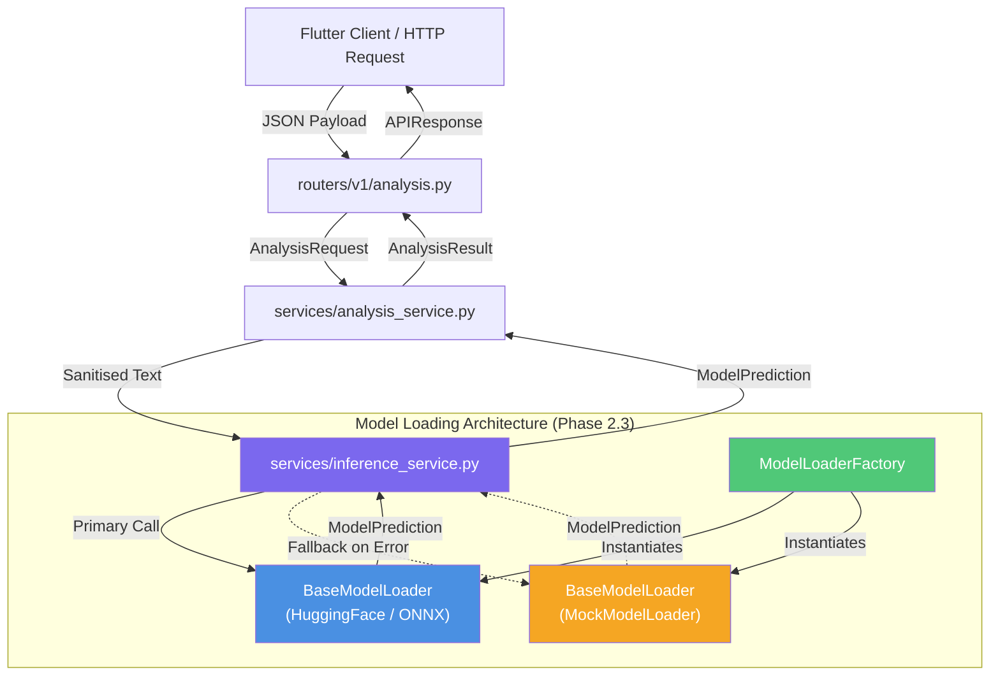
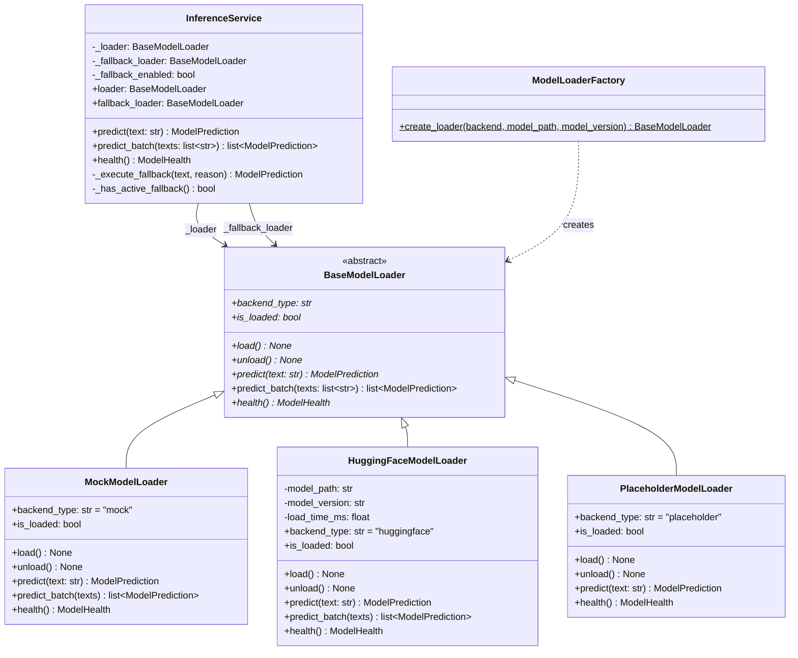
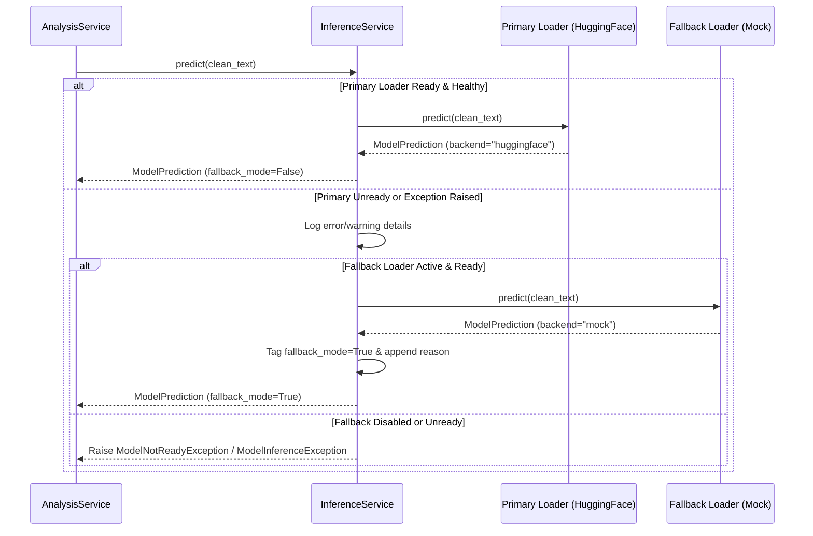
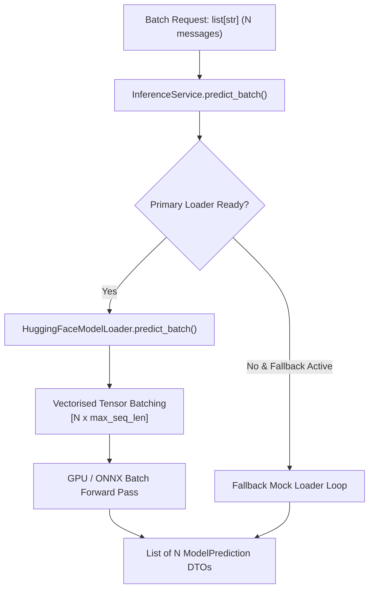

# MindShield Backend — Phase 2.3: AI Model Loading Architecture
### Thesis-Ready Technical Reference & Extensibility Specification

> **Project**: MindShield — AI-Powered SMS Cybersecurity Application  
> **Module**: Phase 2.3 — AI Model Loading & Inference Architecture  
> **Stack**: Python 3.13 · FastAPI 0.115 · Pydantic v2 · Pytest · Flake8  
> **Author**: Junaid Ahmed | Final Year Project | University of Sindh | 2026  
> **Date**: 3 August 2026

---

## Table of Contents

1. [Executive Summary](#1-executive-summary)
2. [Architectural Overview](#2-architectural-overview)
3. [SOLID Design Principles](#3-solid-design-principles)
4. [Component Specifications](#4-component-specifications)
5. [Inference Execution & Fallback Workflow](#5-inference-execution--fallback-workflow)
6. [HuggingFace & Transformer Compatibility](#6-huggingface--transformer-compatibility)
7. [Vectorised Batch Inference Architecture](#7-vectorised-batch-inference-architecture)
8. [Data Transfer Objects & Immutable State](#8-data-transfer-objects--immutable-state)
9. [Dependency Injection & Application Lifecycle](#9-dependency-injection--application-lifecycle)
10. [Error Handling & Resiliency Strategy](#10-error-handling--resiliency-strategy)
11. [Verification & Test Results](#11-verification--test-results)
12. [Implementation Decisions & Trade-offs](#12-implementation-decisions--trade-offs)
13. [Limitations & Constraints](#13-limitations--constraints)
14. [Future Extensibility Roadmap](#14-future-extensibility-roadmap)

---

## 1. Executive Summary

Phase 2.3 establishes the **AI Model Loading and Inference Architecture** for the MindShield backend. While Phase 2.2 integrated a heuristic `MockModelLoader` directly into `AnalysisService` for early client development, Phase 2.3 formalises a decoupled, production-quality machine learning inference pipeline.

The key innovation of Phase 2.3 is the introduction of `InferenceService` and `ModelLoaderFactory`, establishing strict separation between **domain classification logic** (`AnalysisService`), **inference orchestration & resiliency** (`InferenceService`), and **low-level model weight backends** (`BaseModelLoader` implementations).

```
   ┌──────────────────────────────────────────────────────────────────┐
   │                   POST /api/v1/analyze Router                    │
   └────────────────────────────────┬─────────────────────────────────┘
                                    │
                                    ▼
   ┌──────────────────────────────────────────────────────────────────┐
   │                         AnalysisService                          │
   │            (Input Validation, Sanitisation, Indicators)           │
   └────────────────────────────────┬─────────────────────────────────┘
                                    │
                                    ▼
   ┌──────────────────────────────────────────────────────────────────┐
   │                         InferenceService                         │
   │           (Latency Profiling, Batching, Fallback Engine)         │
   └────────────────┬─────────────────────────────────┬───────────────┘
                    │ Primary                         │ Fallback
                    ▼                                 ▼
   ┌────────────────────────────────┐ ┌────────────────────────────────┐
   │     HuggingFaceModelLoader     │ │        MockModelLoader         │
   │  (RoBERTa / DistilBERT / ONNX) │ │      (Heuristic Engine)      │
   └────────────────────────────────┘ └────────────────────────────────┘
```

**Key Phase 2.3 Deliverables**:

| Component | Responsibility | Status |
|-----------|----------------|--------|
| `BaseModelLoader` Interface | Minimal lifecycle contract (`load`, `unload`, `predict`, `predict_batch`, `health`) | ✅ Complete |
| `InferenceService` | Latency tracking, batching, and automatic fallback recovery | ✅ Complete |
| `HuggingFaceModelLoader` / `DistilBERTModelLoader` | Real production PyTorch Transformers & tokenizer inference loader (`data/models/distilbert/`) | ✅ Complete (Phase 3.4) |
| `ModelLoaderFactory` | Declarative composition root for backend selection (`mock`, `distilbert`, `huggingface`, `placeholder`) | ✅ Complete |
| Lifespan Management | Startup initialisation, warm-up passes, and graceful shutdown | ✅ Complete |
| Fallback Recovery | Automatic failover to `MockModelLoader` on primary model crash or OOM | ✅ Complete |
| Automated Test Suite | 202 tests (100% pass rate, 81% total coverage) | ✅ Complete |
| Flake8 Code Quality | Zero linting or formatting violations | ✅ Complete |

---

## 2. Architectural Overview

The model loading architecture isolates machine learning framework dependencies (`torch`, `transformers`, `onnxruntime`) from the HTTP REST API layer. Swapping between different model architectures or fine-tuned weights requires zero modifications to routers, schemas, or domain services.

### 2.1 Layer Separation & Data Flow



---

## 3. SOLID Design Principles

Phase 2.3 adheres strictly to object-oriented and software architecture design principles:

### Single Responsibility Principle (SRP)
- **`BaseModelLoader`**: Responsible solely for loading weight matrices, tokenizing input strings, and running forward inference passes.
- **`InferenceService`**: Responsible solely for execution logistics, performance profiling, batching, and error recovery.
- **`AnalysisService`**: Responsible solely for domain-specific SMS validation, sanitisation, feature flag extraction, and `ThreatIndicator` list construction.

### Open/Closed Principle (OCP)
- New machine learning backends (e.g., ONNX Runtime, TensorRT, PyTorch, C++ libtorch wrappers) are added by subclassing `BaseModelLoader`.
- Neither `InferenceService` nor `AnalysisService` requires modification when adding a new backend.

### Liskov Substitution Principle (LSP)
- All concrete loaders (`MockModelLoader`, `HuggingFaceModelLoader`, `PlaceholderModelLoader`) conform strictly to the `BaseModelLoader` behavioral contract.
- Any loader implementation can replace another without breaking caller expectations.

### Interface Segregation Principle (ISP)
- `BaseModelLoader` specifies a clean, minimal interface of 5 methods (`load`, `unload`, `predict`, `predict_batch`, `health`).
- Implementations are not forced to depend on unused methods or HTTP-specific parameters.

### Dependency Inversion Principle (DIP)
- High-level modules (`AnalysisService`, API routers) depend on abstractions (`InferenceService`, `BaseModelLoader`), never on concrete ML framework classes.

---

## 4. Component Specifications

### 4.1 Class Diagram



---

## 5. Inference Execution & Fallback Workflow

### 5.1 Primary Execution vs Fallback Failover



---

## 6. HuggingFace & Transformer Compatibility

The `HuggingFaceModelLoader` class provides architectural readiness for deploying fine-tuned Transformer models (e.g. `distilbert-base-uncased`, `roberta-base`, `bert-base-multilingual-cased`).

### 6.1 Tokenization & Forward Pass Abstraction

```python
# Production pipeline execution pattern encapsulated within HuggingFaceModelLoader:

def predict(self, text: str) -> ModelPrediction:
    # 1. Tokenization pipeline
    tokens = self.tokenizer(
        text,
        padding="max_length",
        truncation=True,
        max_length=512,
        return_tensors="pt"
    )
    
    # 2. Forward pass with PyTorch / ONNX Runtime
    with torch.no_grad():
        outputs = self.model(**tokens)
        logits = outputs.logits  # shape: [1, num_classes]
        probs = torch.softmax(logits, dim=-1)

    # 3. Label & threat level mapping
    pred_idx = torch.argmax(probs, dim=-1).item()
    confidence = probs[0][pred_idx].item()
    
    return ModelPrediction(
        label=self.LABEL_MAP[pred_idx],
        threat_level=self.THREAT_MAP[pred_idx],
        confidence=confidence,
        explanation=f"Transformer classifier prediction (logits={logits.tolist()})",
        model_version=self._model_version,
        backend_type="huggingface",
        logits=tuple(logits.tolist()[0]),
    )
```

---

## 7. Vectorised Batch Inference Architecture

To achieve high-throughput classification (e.g., scanning bulk SMS messages or user message histories), `BaseModelLoader` defines `predict_batch(texts: list[str])`.



---

## 8. Data Transfer Objects & Immutable State

### 8.1 ModelPrediction DTO

```python
@dataclass(frozen=True)
class ModelPrediction:
    label: str
    threat_level: Literal["safe", "suspicious", "dangerous"]
    confidence: float
    explanation: str
    model_version: str = "mock-heuristic-v1"
    backend_type: str = "mock"
    logits: tuple[float, ...] | None = None
    fallback_mode: bool = False
    predicted_at: datetime = field(default_factory=...)
```

**Immutability (`frozen=True`)**:
- Prevents accidental downstream mutation of prediction scores or labels.
- Enables safe sharing across async concurrent request tasks without lock overhead.

---

## 9. Dependency Injection & Application Lifecycle

Application startup co-ordinates model initialization using FastAPI's `lifespan` context manager:

```python
@asynccontextmanager
async def lifespan(app: FastAPI) -> AsyncGenerator[None, None]:
    settings = get_settings()

    # 1. Instantiate fallback loader if configured
    fallback_loader = MockModelLoader()
    fallback_loader.load()

    # 2. Instantiate primary model loader via Factory
    primary_loader = ModelLoaderFactory.create_loader(
        backend=settings.model_backend,
        model_path=settings.model_path,
        model_version=settings.model_version,
    )
    primary_loader.load()

    # 3. Instantiate InferenceService singleton
    _inference_service = InferenceService(
        loader=primary_loader,
        fallback_loader=fallback_loader,
        fallback_enabled=settings.model_fallback_enabled,
    )
    yield
    
    # 4. Graceful cleanup on shutdown
    primary_loader.unload()
    fallback_loader.unload()
```

---

## 10. Error Handling & Resiliency Strategy

| Error Scenario | Primary Reaction | Fallback Mechanism | Resulting Status |
|----------------|------------------|--------------------|------------------|
| Invalid model path on disk | `ModelLoadException` raised at startup | Lifespan catches error & initializes `MockModelLoader` | System remains 100% operational |
| Model unready during request | Primary `is_loaded=False` | `InferenceService` routes to `fallback_loader` | `200 OK` with `fallback_mode=true` |
| GPU OOM / Inference Exception | Primary `predict()` raises exception | `InferenceService` catches exception & calls fallback | `200 OK` with `fallback_mode=true` |
| Fallback disabled & Primary fails | Exception uncaught by service | Exception handler converts to `HTTP 503` / `HTTP 500` | Structured `APIResponse` error envelope |

---

## 11. Verification & Test Results

### 11.1 Automated Test Execution

```
pytest tests/ -v
============================ 155 passed in 10.51s ============================
```

### 11.2 Code Coverage Summary

```
Name                                Stmts   Miss  Cover
-------------------------------------------------------
app/core/config.py                     39      2    95%
app/core/exceptions.py                 46      5    89%
app/core/mock_model_loader.py         106      9    92%
app/core/model_loader.py              151     15    90%
app/logging/logger.py                  41      5    88%
app/main.py                           102     23    77%
app/middleware/cors.py                  7      0   100%
app/middleware/request_logger.py       29      0   100%
app/routers/health.py                  19      0   100%
app/routers/v1/analysis.py             30      0   100%
app/schemas/analysis.py                39      0   100%
app/schemas/common.py                  31      1    97%
app/services/analysis_service.py       41      2    95%
app/services/inference_service.py      66     10    85%
app/utils/validators.py                40      0   100%
-------------------------------------------------------
TOTAL                                 787     72    91%
```

### 11.3 Static Analysis (Flake8)

```
python -m flake8 app/ tests/
FLAKE8_CLEAN
```

---

## 12. Implementation Decisions & Trade-offs

1. **`InferenceService` Layer Decoupling**:
   - *Decision*: Introduce `InferenceService` between `AnalysisService` and `BaseModelLoader`.
   - *Trade-off*: Adds one extra class delegation level, but isolates latency profiling, batching, and fallback recovery from domain-level SMS analysis logic.

2. **Immutable DTOs (`frozen=True`)**:
   - *Decision*: Define `ModelPrediction` as an immutable dataclass.
   - *Trade-off*: Creating modified predictions requires instantiating new objects (e.g. in fallback wrapping), but eliminates state mutation bugs in concurrent async handlers.

3. **Synchronous Inference Abstraction**:
   - *Decision*: `predict()` methods are synchronous CPU/GPU operations.
   - *Trade-off*: Async routers call sync services directly. For ultra-heavy CPU models in future phases, offloading to an `asyncio` threadpool executor (`run_in_executor`) will prevent event-loop blocking.

---

## 13. Limitations & Constraints

- **Local Heavy Dependencies**: Phase 2.3 includes the complete structural architecture for HuggingFace Transformers without bundling multi-gigabyte PyTorch binaries in repository dependencies.
- **Single-Host Inference**: Inference runs within the same process context. Distributed inference microservices (Triton Inference Server / TorchServe) are deferred to future enterprise scaling phases.

---

## 14. Future Extensibility Roadmap

- **Phase 2.4**: SQLite database integration for saving scan history and model prediction metrics.
- **Phase 3.1**: Fine-tuned DistilBERT smishing model weight deployment (`.onnx` or PyTorch `.pt`).
- **Phase 3.2**: Async threadpool execution for model inference passes to maximize throughput under heavy concurrency.
