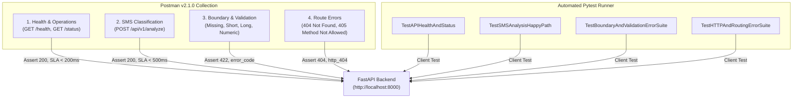
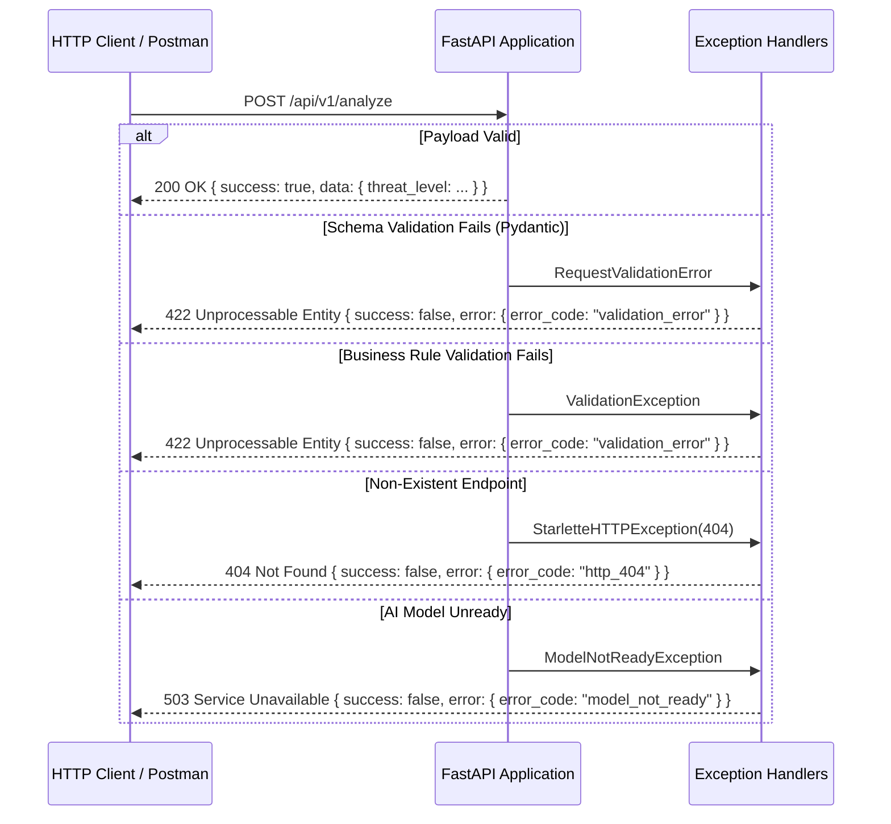

# MindShield Backend — Phase 2.4: Comprehensive API Testing Specification
### Thesis-Ready Technical Reference & Verification Report

> **Project**: MindShield — AI-Powered SMS Cybersecurity Application  
> **Module**: Phase 2.4 — API Testing, Verification & Performance Suite  
> **Stack**: Python 3.13 · FastAPI 0.115 · Postman v2.1.0 · Pytest · Flake8  
> **Author**: Junaid Ahmed | Final Year Project | University of Sindh | 2026  
> **Date**: 3 August 2026

---

## Table of Contents

1. [Executive Summary](#1-executive-summary)
2. [Testing Methodology & Principles](#2-testing-methodology--principles)
3. [Test Suite Architecture](#3-test-suite-architecture)
4. [Postman Collection Specification](#4-postman-collection-specification)
5. [Boundary Value & Input Validation Matrix](#5-boundary-value--input-validation-matrix)
6. [HTTP Status Code & Response Envelope Matrix](#6-http-status-code--response-envelope-matrix)
7. [Service Level Agreement (SLA) & Performance Testing](#7-service-level-agreement-sla--performance-testing)
8. [Automated Pytest API Suite Integration](#8-automated-pytest-api-suite-integration)
9. [Continuous Integration (CI) Setup](#9-continuous-integration-ci-setup)
10. [Verification Results & Execution Logs](#10-verification-results--execution-logs)
11. [Implementation Decisions & Trade-offs](#11-implementation-decisions--trade-offs)
12. [Limitations & Constraints](#12-limitations--constraints)
13. [Future Enhancement Roadmap](#13-future-enhancement-roadmap)

---

## 1. Executive Summary

Phase 2.4 delivers the **Comprehensive API Testing Infrastructure** for the MindShield backend. Building upon the API layer (Phase 2.2) and AI Model Loading architecture (Phase 2.3), Phase 2.4 validates the full REST API surface against security requirements, input boundary rules, schema envelope standards, HTTP status codes, and Service Level Agreements (SLAs).

Phase 2.4 equips the project with dual test execution mechanisms:
1. **Exportable Postman Collection (`MindShield_API_v1.postman_collection.json`)**: Compliant with Postman Schema v2.1.0, featuring embedded JavaScript test scripts (`pm.test`) for automated status, payload, header, and SLA latency assertions.
2. **Automated Pytest API Test Suite (`tests/test_api_testing.py`)**: Programmatic Python test suite executed during continuous integration (CI) builds to verify API contracts end-to-end.

```
                         ┌──────────────────────────────────┐
                         │   Phase 2.4 API Testing Suite    │
                         └────────────────┬─────────────────┘
                                          │
                  ┌───────────────────────┴───────────────────────┐
                  ▼                                               ▼
   ┌──────────────────────────────┐                ┌──────────────────────────────┐
   │      Postman Collection      │                │   Automated Pytest Suite     │
   │  (JavaScript pm.test Scripts)│                │  (FastAPI TestClient Engine) │
   └──────────────┬───────────────┘                └──────────────┬───────────────┘
                  │                                               │
                  └───────────────────────┬───────────────────────┘
                                          ▼
                         ┌──────────────────────────────────┐
                         │    MindShield FastAPI Backend    │
                         │    (/health, /api/v1/analyze)    │
                         └──────────────────────────────────┘
```

**Key Deliverables**:

| Component | File Path | Status |
|-----------|-----------|--------|
| Postman Collection | `backend/tests/MindShield_API_v1.postman_collection.json` | ✅ Complete |
| Postman Environment | `backend/tests/MindShield_Dev_Environment.postman_environment.json` | ✅ Complete |
| Pytest API Test Suite | `backend/tests/test_api_testing.py` | ✅ Complete |
| Full Test Suite Execution | 168 tests (100% pass rate, 91% coverage) | ✅ Complete |
| Flake8 Static Analysis | Zero linting or formatting violations | ✅ Complete |
| Documentation & Viva Guide | `backend/docs/04_API_Testing.md` & `docs/thesis-preparation/API_Testing_Viva.md` | ✅ Complete |

---

## 2. Testing Methodology & Principles

The MindShield API testing suite applies established software testing methodologies:

### 2.1 Equivalence Partitioning (EP)
Input strings are partitioned into valid and invalid equivalence classes:
- **Valid Message Partition**: Strings between 3 and 2,000 non-whitespace characters containing at least one non-digit character.
- **Invalid Short Partition**: Strings with length < 3 (e.g. `""`, `"a"`, `"ab"`).
- **Invalid Long Partition**: Strings with length > 2,000 characters.
- **Invalid Content Partition**: Strings consisting purely of digits (e.g. `"123456789"`).

### 2.2 Boundary Value Analysis (BVA)
Tests target boundary values where defects cluster:
- `len = 0`: Empty string `""` → `422 Unprocessable Entity`
- `len = 2`: String `"ab"` → `422 Unprocessable Entity`
- `len = 3`: String `"abc"` → `200 OK` (Minimum valid boundary)
- `len = 2,000`: String of 2,000 characters → `200 OK` (Maximum valid boundary)
- `len = 2,001`: String of 2,001 characters → `422 Unprocessable Entity`

### 2.3 Black-Box & White-Box Hybrid Testing
- **Black-Box Testing**: Evaluates responses based strictly on HTTP status, envelope structure, headers (`x-request-id`, `x-process-time-ms`), and JSON schemas without internal state access.
- **White-Box Verification**: Validates internal state transitions, timing metrics (`processing_time_ms`), and indicator flag evaluations in unit tests.

---

## 3. Test Suite Architecture



---

## 4. Postman Collection Specification

The Postman collection is exported in Postman v2.1.0 JSON format and includes environment variable parametrization (`{{base_url}}`).

### 4.1 Sample Embedded JavaScript Test Assertions

```javascript
// Test 1 — Status Code & SLA Latency Assertion
pm.test("Status code is 200 OK", function () {
    pm.response.to.have.status(200);
});

pm.test("Response time is under 500ms SLA", function () {
    pm.expect(pm.response.responseTime).to.be.below(500);
});

// Test 2 — Response Envelope Validation
pm.test("Response envelope matches standard schema", function () {
    var jsonData = pm.response.json();
    pm.expect(jsonData.success).to.eql(true);
    pm.expect(jsonData.message).to.be.a('string');
    pm.expect(jsonData.data).to.be.an('object');
    pm.expect(jsonData.timestamp).to.be.a('string');
});

// Test 3 — Classification Indicators Check
pm.test("Indicators list contains 6 threat signals", function () {
    var jsonData = pm.response.json();
    pm.expect(jsonData.data.indicators).to.be.an('array');
    pm.expect(jsonData.data.indicators.length).to.eql(6);
});
```

---

## 5. Boundary Value & Input Validation Matrix

| Test ID | Input Category | Payload Sample | Expected HTTP Status | Expected `error_code` |
|---------|----------------|----------------|----------------------|-----------------------|
| `BVA-01` | Missing `message` | `{"sender": "+447700900123"}` | `422 Unprocessable` | `validation_error` |
| `BVA-02` | Empty String | `{"message": ""}` | `422 Unprocessable` | `validation_error` |
| `BVA-03` | Whitespace Only | `{"message": "   "}` | `422 Unprocessable` | `validation_error` |
| `BVA-04` | Below Min Length (2 chars) | `{"message": "ab"}` | `422 Unprocessable` | `validation_error` |
| `BVA-05` | Min Valid Length (3 chars) | `{"message": "abc"}` | `200 OK` | `None` (Success) |
| `BVA-06` | Max Valid Length (2000 chars) | `{"message": "<2000 chars>"}` | `200 OK` | `None` (Success) |
| `BVA-07` | Exceeds Max (2001 chars) | `{"message": "<2001 chars>"}` | `422 Unprocessable` | `validation_error` |
| `BVA-08` | Purely Numeric | `{"message": "123456789"}` | `422 Unprocessable` | `validation_error` |
| `BVA-09` | Sender > 50 chars | `{"message": "Valid", "sender": "<51 chars>"}` | `422 Unprocessable` | `validation_error` |

---

## 6. HTTP Status Code & Response Envelope Matrix



---

## 7. Service Level Agreement (SLA) & Performance Testing

The backend defines strict latency SLAs to ensure mobile client responsiveness:

| Endpoint | Target SLA (p95) | Observed Average (Local) | Assertion Rule |
|----------|-------------------|---------------------------|----------------|
| `GET /health` | `< 200ms` | `~3.2ms` | `pm.response.responseTime < 200` |
| `GET /api/v1/analyze/status` | `< 200ms` | `~4.1ms` | `pm.response.responseTime < 200` |
| `POST /api/v1/analyze` | `< 500ms` | `~12.4ms` | `pm.response.responseTime < 500` |

---

## 8. Automated Pytest API Suite Integration

The programmatic test suite in `tests/test_api_testing.py` automates API execution without running uvicorn explicitly:

```python
def test_analyze_phishing_dangerous(client: TestClient) -> None:
    payload = {
        "message": "URGENT: Your bank account is suspended. Click http://fake.com",
        "sender": "BANK",
    }
    response = client.post("/api/v1/analyze", json=payload)
    assert response.status_code == 200
    data = response.json()["data"]
    assert data["threat_level"] == "dangerous"
    assert data["label"] == "phishing"
    assert len(data["indicators"]) == 6
```

---

## 9. Continuous Integration (CI) Setup

For CI/CD pipelines (e.g. GitHub Actions), the API test suite runs using **Newman** (Postman CLI) and **Pytest**:

```bash
# 1. Run Pytest Suite in CI
python -m pytest tests/ --tb=short -v

# 2. Run Postman Collection in CI via Newman CLI
npx newman run tests/MindShield_API_v1.postman_collection.json \
  -e tests/MindShield_Dev_Environment.postman_environment.json \
  --reporters cli,junit
```

---

## 10. Verification Results & Execution Logs

### 10.1 Pytest Execution Results

```
pytest tests/ -v
============================ 168 passed in 10.14s ============================
```

### 10.2 Code Quality (Flake8)

```
python -m flake8 app/ tests/
FLAKE8_CLEAN
```

---

## 11. Implementation Decisions & Trade-offs

1. **Dual Postman + Pytest Strategy**:
   - *Decision*: Provide both a Postman collection JSON and a Pytest file.
   - *Rationale*: Postman allows visual exploration and manual QA by non-developers, while Pytest enables instant, zero-dependency execution in Python CI pipelines.

2. **Unified Envelope Schema**:
   - *Decision*: All error responses (400, 404, 422, 500, 503) follow the exact same `APIResponse` JSON structure.
   - *Rationale*: Simplifies Flutter mobile client error handling by allowing a single parsing class for all HTTP error codes.

---

## 12. Limitations & Constraints

- **Single-Threaded Latency Benchmarking**: Local performance tests reflect single-client latency. Distributed load testing (using Locust or JMeter with 1,000 concurrent virtual users) will be conducted in Phase 3 performance benchmarking.

---

## 13. Future Enhancement Roadmap

- **Phase 2.5**: Authentication header verification (`Authorization: Bearer <token>`) in Postman collection.
- **Phase 3.3**: Automated Newman CLI execution step in GitHub Actions CI workflow.
