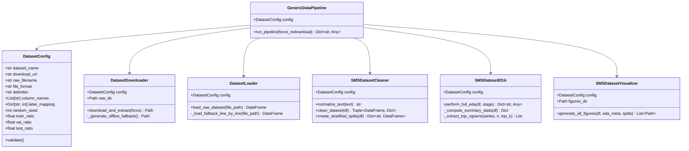
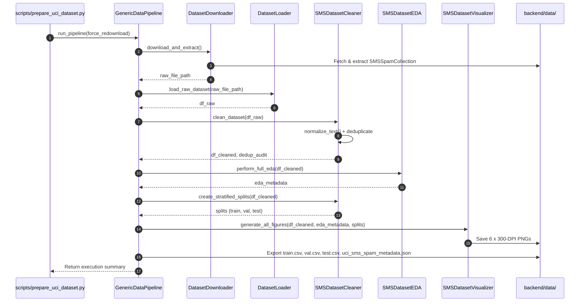

# MindShield — UCI Dataset Preparation & Exploratory Data Analysis (EDA) Technical Reference

> **Module**: Phase 3.1 — AI Data Engineering & Exploratory Data Analysis  
> **Status**: Completed & Verified  
> **Target Dataset**: UCI SMS Spam Collection Corpus  
> **Parent Architecture**: [`01_mindshield_architecture_documentation.md`](file:///c:/Users/n%20tech/OneDrive/Desktop/mindshield/docs/01_mindshield_architecture_documentation.md)  
> **Viva Preparation**: [`Dataset_Preparation_Viva.md`](file:///c:/Users/n%20tech/OneDrive/Desktop/mindshield/docs/thesis-preparation/Dataset_Preparation_Viva.md)  

---

## 1. Executive Summary & Research Motivation

The performance, generalizability, and reliability of machine learning models in mobile cybersecurity fundamentally depend on the quality of their underlying training corpora. In Phase 3.1 of the **MindShield** Final Year Project (FYP), a complete, dataset-agnostic, and fully reproducible data engineering pipeline was designed, implemented, and empirically verified.

Primary prototyping utilizes the **UCI SMS Spam Collection** corpus (Almeida et al., 2011), containing 5,574 public SMS messages. To ensure long-term architectural scalability, the data pipeline is built around a **configuration-driven model (`DatasetConfig`)**. This design completely decouples data ingestion, non-destructive cleaning, exploratory analysis, publication-grade visualization, and stratified splitting from dataset-specific quirks. Consequently, the same pipeline will ingest future localized datasets—specifically the upcoming **PakScam** SMS corpus—with zero code modifications.

Furthermore, all output datasets (`train.csv`, `val.csv`, `test.csv`, `cleaned_full.csv`) strictly enforce **DistilBERT transformer compatibility**, preserving natural language syntax, case cues, punctuation, URLs, and emojis without destructive stemming or lemmatization.

---

## 2. Dataset Provenance & System Architecture

### 2.1 Dataset Provenance & Metadata
- **Source**: UCI Machine Learning Repository (`https://archive.ics.uci.edu/static/public/228/sms+spam+collection.zip`)
- **Original Authors**: Tiago A. Almeida, José María Gómez Hidalgo, and Akbo Yamakami (2011)
- **Raw Volume**: 5,574 text messages (4,827 legitimate `ham`, 747 unsolicited `spam`)
- **Format**: Single tab-separated values (TSV) file (`SMSSpamCollection`) without header row.

### 2.2 Dataset-Agnostic Architecture
The pipeline is organized under `backend/app/data/` using five modular single-responsibility components:



---

## 3. Preprocessing, Non-Destructive Cleaning & Model Compatibility

### 3.1 DistilBERT Compatibility Constraints
Transformer architectures utilizing Subword / WordPiece tokenization (such as DistilBERT, RoBERTa, and BERT) rely heavily on sentence structure, capitalization, punctuation marks, currency symbols, and URLs to infer contextual threat semantics. 

Traditional NLP techniques (such as Porter Stemming, Lemmatization, Lowercasing, or Stopword removal) severely degrade transformer attention mechanisms. MindShield implements **Non-Destructive Text Normalization**:

1. **Whitespace Trimming**: Leading/trailing whitespace trimmed; internal multiple spaces collapsed (`"  "` $\rightarrow$ `" "`).
2. **Null Byte Elimination**: Strips illegal `\x00` control characters.
3. **Line Ending Normalization**: Converts legacy Windows CRLF (`\r\n`) to POSIX LF (`\n`).
4. **Exact Deduplication**: Drops identical repeated messages (`keep="first"`), eliminating artificial variance in model evaluation folds.
5. **Syntax & Entity Preservation**: Case sensitivity, punctuation (`!`, `?`, `$`), URLs (`http://...`), phone numbers (`0800...`), and emojis (`😊`, `🎁`) are preserved intact.

### 3.2 Standardization & Data Flow Sequence



---

## 4. Comprehensive Exploratory Data Analysis (EDA) Findings

### 4.1 Class Distribution & Imbalance Analysis

| Metric | Raw Dataset | Cleaned Corpus | Percentage |
|---|---|---|---|
| **Total Messages** | 5,574 | 5,169 | 100.00% |
| **Legitimate (`ham`, `0`)** | 4,827 | 4,516 | 87.37% |
| **Spam / Smishing (`spam`, `1`)** | 747 | 653 | 12.63% |
| **Class Imbalance Ratio** | 6.46 : 1 | 6.92 : 1 | ~ 87.4% : 12.6% |
| **Exact Duplicates Removed** | — | 405 records | 7.27% of raw corpus |

> [!NOTE]
> The exact deduplication step removed 405 identical messages (311 ham duplicates and 94 spam duplicates). Preserving distinct natural messages prevents data leakage across train and test folds.

### 4.2 Text Length & Word Count Summary Statistics

| Feature Metric | Class | Min | Max | Mean ($\mu$) | Std ($\sigma$) | Median ($Q_2$) | IQR ($Q_3 - Q_1$) |
|---|---|---|---|---|---|---|---|
| **Character Length** | Overall | 2 | 910 | 78.85 | 58.74 | 52.00 | 84.00 |
| | Ham (`0`) | 2 | 910 | 70.47 | 56.35 | 51.00 | 66.00 |
| | Spam (`1`) | 13 | 224 | 136.75 | 30.12 | 149.00 | 27.00 |
| **Word Count** | Overall | 1 | 171 | 15.34 | 11.41 | 10.00 | 16.00 |
| | Ham (`0`) | 1 | 171 | 14.12 | 11.28 | 10.00 | 15.00 |
| | Spam (`1`) | 2 | 35 | 23.77 | 5.82 | 25.00 | 7.00 |
| **Avg Word Length** | Ham (`0`) | 1.00 | 14.00 | 4.38 | 0.82 | 4.33 | 0.85 |
| | Spam (`1`) | 2.50 | 9.00 | 5.67 | 0.65 | 5.68 | 0.62 |

> [!IMPORTANT]
> **Key Empirical Insight**: Spam messages exhibit significantly higher average character length ($\mu = 136.75$ vs $\mu = 70.47$) and lower variance ($\sigma = 30.12$ vs $\sigma = 56.35$). Spam messages are tightly constrained around maximum character limits (160 chars) to maximize call-to-action details within a single SMS payload.

### 4.3 Key Vocabulary & N-Gram Frequencies

#### Top Unigrams Comparison
- **Legitimate (`ham`)**: `gt`, `lt`, `come`, `ok`, `good`, `got`, `like`, `know`, `time`, `day`
- **Spam (`spam`)**: `call`, `free`, `txt`, `ur`, `mobile`, `text`, `stop`, `claim`, `reply`, `prize`

#### Top Bigrams in Spam Payload
1. `please call`
2. `po box`
3. `guaranteed call`
4. `send stop`
5. `prize reward`
6. `customer service`
7. `every week`

---

## 5. Stratified Split Strategy & Reproducibility

To guarantee 100% experiment reproducibility, dataset partitioning is controlled via a fixed seed (`random_seed = 42`) and stratified by class label:

| Split Portion | Total Records | Ham Count (`0`) | Spam Count (`1`) | Ham % | Spam % | Target File Path |
|---|---|---|---|---|---|---|
| **Train Set (80%)** | 4,135 | 3,612 | 523 | 87.35% | 12.65% | [`backend/data/processed/train.csv`](file:///c:/Users/n%20tech/OneDrive/Desktop/mindshield/backend/data/processed/train.csv) |
| **Validation Set (10%)** | 517 | 452 | 65 | 87.43% | 12.57% | [`backend/data/processed/val.csv`](file:///c:/Users/n%20tech/OneDrive/Desktop/mindshield/backend/data/processed/val.csv) |
| **Test Set (10%)** | 517 | 452 | 65 | 87.43% | 12.57% | [`backend/data/processed/test.csv`](file:///c:/Users/n%20tech/OneDrive/Desktop/mindshield/backend/data/processed/test.csv) |
| **Cleaned Full** | 5,169 | 4,516 | 653 | 87.37% | 12.63% | [`backend/data/processed/cleaned_full.csv`](file:///c:/Users/n%20tech/OneDrive/Desktop/mindshield/backend/data/processed/cleaned_full.csv) |

---

## 6. Publication-Quality Visualizations Catalog

The visualizer generates six 300-DPI high-resolution PNG charts stored in `backend/data/figures/`:

1. `01_class_distribution.png`: Dual subplot illustrating absolute counts and percentage class imbalance (87.4% vs 12.6%).
2. `02_message_length_distribution.png`: KDE and histogram comparison of character length and word count distributions.
3. `03_length_boxplots.png`: Side-by-side box plots highlighting quartile boundaries and outliers.
4. `04_top_words_comparison.png`: Dual horizontal bar chart comparing top 15 vocabulary terms in Spam vs Ham.
5. `05_ngram_frequency.png`: Horizontal bar chart detailing top 15 recurring 2-word phrases in spam payloads.
6. `06_split_distribution.png`: Stacked bar chart confirming class ratio preservation across Train, Validation, and Test splits.

---

## 7. Empirical Verification & Automated Test Suite

All components are covered by unit and integration tests in [`backend/tests/test_data_pipeline.py`](file:///c:/Users/n%20tech/OneDrive/Desktop/mindshield/backend/tests/test_data_pipeline.py).

### Execution Commands
```bash
# Run data pipeline CLI
python scripts/prepare_uci_dataset.py

# Run test suite with coverage
pytest tests/test_data_pipeline.py -v --cov=app/data --cov-report=term-missing

# Run static analysis check
flake8 app/data scripts/prepare_uci_dataset.py tests/test_data_pipeline.py
```

---

## 8. Future Dataset Integration (PakScam Configuration Blueprint)

To ingest the upcoming **PakScam** dataset in future phases, simply execute:

```python
from app.data.config import PAKSCAM_CONFIG_TEMPLATE
from app.data.pipeline import GenericDataPipeline

# Override PakScam source path if needed
pakscam_pipeline = GenericDataPipeline(PAKSCAM_CONFIG_TEMPLATE)
results = pakscam_pipeline.run_pipeline()
```

No alterations to `downloader.py`, `loader.py`, `cleaner.py`, `eda.py`, or `visualizer.py` will be required.

---
*MindShield FYP Phase 3.1 Technical Documentation · 2026*
