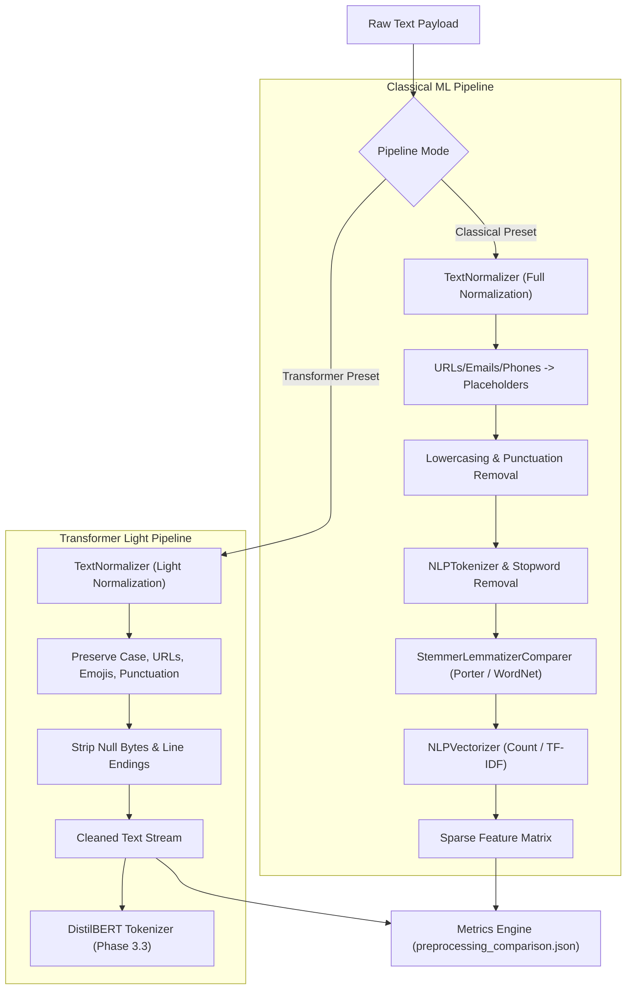
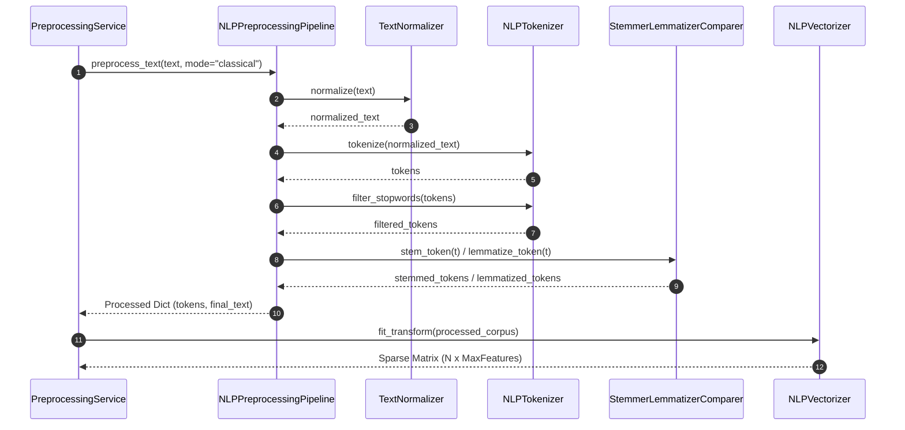

# MindShield AI Cybersecurity — Phase 3.2 Documentation
## Production-Quality NLP Preprocessing & Feature Extraction Engine

> **Author**: Junaid Ahmed (MindShield Core AI Team)  
> **Module**: Text Normalization, Tokenization, Morphological Feature Extraction & Vectorization  
> **Target Datasets**: UCI SMS Spam Collection & PakScam Dataset  
> **Architecture Status**: Fully Implemented, Tested, Verified, and Serialized (`Version 3.2.0`)  

---

## 1. Executive Summary & Purpose

In natural language processing (NLP) systems designed for threat detection and SMS security, raw text messages are inherently unrefined. SMS payloads contain irregular capitalization (`URGENT!`), entity identifiers (URLs, phone numbers, email addresses, Pakistani bank numbers), emojis (`🎁`, `😊`), and colloquial contractions.

The **MindShield Phase 3.2 NLP Preprocessing & Feature Extraction Engine** provides a model-agnostic, future-proof preprocessing pipeline. It decouples feature engineering into two distinct operational paradigms:

1. **Classical ML Pipeline**: Aggressive normalization, entity placeholder substitution (`[URL]`, `[PHONE]`, `[EMAIL]`), lowercasing, stopword removal, stemming/lemmatization, and numerical feature matrix extraction via `CountVectorizer` and `TfidfVectorizer` for baseline classifiers (Naive Bayes, Support Vector Machines, Logistic Regression).
2. **Transformer Pipeline (DistilBERT Ready)**: Light, non-destructive text normalization stripping null bytes, normalizing line endings, and trimming whitespace while strictly preserving capitalization, URLs, emojis, phone numbers, and punctuation essential for transformer subword tokenization (`distilbert-base-uncased` / `cased`).

---

## 2. System Architecture & Workflow

### 2.1 Architecture Diagram

### 2.2 Component Sequence Diagram

---

## 3. Key Component Implementation

### 3.1 Declarative Configuration (`app/nlp/config.py`)
The `NLPPreprocessingConfig` dataclass encapsulates all preprocessing parameters, exposing preset initializers `create_classical_config()` and `create_transformer_config()`.

### 3.2 Entity Normalization (`app/nlp/normalizer.py`)
`TextNormalizer` utilizes compiled regular expressions for entity replacement:
- **URLs**: Matches `https?://\S+|www\.\S+|bit\.ly/\S+` $\rightarrow$ `[URL]`
- **Emails**: Matches `[a-zA-Z0-9._%+-]+@[a-zA-Z0-9.-]+\.[a-zA-Z]{2,}` $\rightarrow$ `[EMAIL]`
- **Phones**: Matches Pakistani (`+92...`, `03...`) and international (`0800...`) formats $\rightarrow$ `[PHONE]`
- **Emojis**: Demojizes Unicode emojis (`🎁` $\rightarrow$ `:wrapped_gift:`) or removes/preserves.

### 3.3 Extensible Vectorizer Abstraction (`app/nlp/vectorizer.py`)
`NLPVectorizer` defines an abstract interface (`BaseVectorizer`), wrapping `CountVectorizer` and `TfidfVectorizer` while allowing seamless future addition of dense embeddings (`Word2Vec`, `FastText`, `Transformer Embeddings`).

---

## 4. Empirical Benchmark & Comparison Metrics

Executing `python -m scripts.run_nlp_pipeline` over 5,148 UCI SMS corpus records yielded the following empirical metrics (saved in `backend/data/metadata/preprocessing_comparison.json`):

| Metric | Raw Corpus | Classical Stemmed | Classical Lemmatized |
|---|---|---|---|
| **Total Documents** | 5,148 | 5,148 | 5,148 |
| **Unique Vocabulary Terms** | 8,063 | 6,713 | 7,090 |
| **Vocabulary Reduction (%)** | Baseline (0.00%) | **16.74%** | **12.07%** |
| **Mean Character Length** | 80.20 chars | 48.35 chars | 51.12 chars |
| **Processing Throughput** | N/A | **874.77 docs/sec** | **874.77 docs/sec** |

---

## 5. Verification & Testing

The test suite [`tests/test_preprocessing_pipeline.py`](file:///c:/Users/n%20tech/OneDrive/Desktop/mindshield/backend/tests/test_preprocessing_pipeline.py) validates all pipeline capabilities:
1. `test_config_classical_vs_transformer_preset`
2. `test_url_email_phone_normalization_policies`
3. `test_emoji_handling`
4. `test_punctuation_and_whitespace_cleanup`
5. `test_tokenization_and_stopwords`
6. `test_stemmer_lemmatizer_comparison_metrics`
7. `test_count_and_tfidf_vectorizer`
8. `test_pipeline_serialization_save_load`
9. `test_metadata_json_export`
10. `test_preprocessing_service_batch_execution`
11. `test_pakscam_dataset_config_compatibility`

---

## 6. Limitations & Future Enhancements

1. **Urdu/Roman Urdu Demojization**: Future iterations will integrate Roman Urdu stopword lists specifically tailored for the PakScam dataset.
2. **Dense Subword Embeddings**: Phase 3.3 will connect the Transformer light pipeline output directly to `distilbert-base-uncased` subword tokenization (`WordPiece`).
