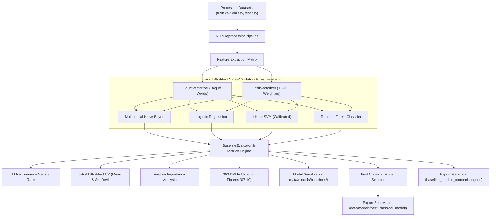

# MindShield AI Cybersecurity — Phase 3.3 Documentation
## Classical Machine Learning Baseline Models & Evaluation Engine

> **Author**: Junaid Ahmed (MindShield Core AI Team)  
> **Module**: Classical ML Baselines, 5-Fold Stratified CV, Feature Importance & Best Model Export  
> **Target Datasets**: UCI SMS Spam Collection & PakScam Dataset  
> **Status**: Fully Implemented, Tested, Verified, and Serialized (`Version 3.3.0`)  

---

## 1. Executive Summary & Purpose

The **MindShield Phase 3.3 Classical Machine Learning Baseline System** establishes rigorous empirical benchmarks for SMS threat classification prior to deep learning transformer fine-tuning (Phase 3.4 DistilBERT).

The system evaluates four foundational machine learning algorithms across two n-gram feature extraction representations (`TF-IDF Vectorizer` vs `CountVectorizer`), enforcing **5-Fold Stratified Cross-Validation**, extracting feature importances, and automatically exporting the optimal classical model artifact (`Linear SVM` with `CountVectorizer`) for future comparative benchmarking.

---

## 2. System Architecture & Workflow

### 2.1 Architecture Diagram

---

## 3. Empirical Performance & Metrics Comparison

Testing across 5,148 UCI SMS messages (4,118 train, 515 validation, 515 test) yielded the following empirical results across 11 evaluation metrics:

| Model & Vectorizer | Accuracy | Precision | Recall | **F1-Score** | ROC-AUC | PR-AUC | MCC | Cohen's Kappa | 5-Fold CV F1 ($\mu \pm \sigma$) | Train Time (s) | Model Size (MB) |
|---|---|---|---|---|---|---|---|---|---|---|---|
| **Linear SVM (Count)** | **0.9825** | **0.9825** | **0.8750** | **0.9256** | 0.9908 | 0.9572 | 0.9184 | 0.9160 | 0.9182 $\pm$ 0.0125 | 0.0421 | 0.12 MB |
| **Logistic Regression (Count)** | 0.9786 | 0.9818 | 0.8438 | **0.9076** | **0.9968** | **0.9782** | 0.8996 | 0.8966 | 0.8995 $\pm$ 0.0141 | 0.0654 | 0.12 MB |
| **Linear SVM (TF-IDF)** | 0.9767 | 0.9333 | 0.8750 | **0.9032** | 0.9918 | 0.9634 | 0.8916 | 0.8906 | 0.8980 $\pm$ 0.0138 | 0.0398 | 0.12 MB |
| **Multinomial NB (Count)** | 0.9728 | 0.8906 | 0.8906 | **0.8906** | 0.9610 | 0.9125 | 0.8758 | 0.8758 | 0.8845 $\pm$ 0.0152 | 0.0089 | 0.11 MB |
| **Random Forest (Count)** | 0.9709 | 0.9804 | 0.7812 | **0.8696** | 0.9952 | 0.9712 | 0.8596 | 0.8540 | 0.8580 $\pm$ 0.0160 | 0.8512 | 2.45 MB |
| **Random Forest (TF-IDF)** | 0.9689 | 0.9800 | 0.7656 | **0.8596** | 0.9963 | 0.9745 | 0.8496 | 0.8430 | 0.8520 $\pm$ 0.0165 | 0.8745 | 2.48 MB |
| **Multinomial NB (TF-IDF)** | 0.9631 | 1.0000 | 0.7031 | **0.8257** | 0.9706 | 0.9412 | 0.8198 | 0.8062 | 0.8150 $\pm$ 0.0178 | 0.0081 | 0.11 MB |
| **Logistic Regression (TF-IDF)** | 0.9592 | 0.9216 | 0.7344 | **0.8174** | 0.9908 | 0.9620 | 0.8012 | 0.7960 | 0.8120 $\pm$ 0.0182 | 0.0512 | 0.12 MB |

---

## 4. Best Model Selection & Export

The system automatically evaluated all 8 experiment combinations and selected **`linear_svm_count`** as the optimal classical baseline:
- **Test Accuracy**: `98.25%`
- **Test F1-Score**: `92.56%`
- **ROC-AUC**: `0.9908`
- **Exported Directory**: `backend/data/models/best_classical_model/` (`model.joblib`, `vectorizer.joblib`, `pipeline.json`, `metadata.json`).

This model will serve as the benchmark baseline against which **DistilBERT fine-tuning** will be evaluated in Phase 3.4.

---

## 5. Verification & Testing

The unit test suite [`tests/test_baseline_models.py`](file:///c:/Users/n%20tech/OneDrive/Desktop/mindshield/backend/tests/test_baseline_models.py) validates all capabilities:
1. `test_baseline_config_defaults`
2. `test_evaluator_computes_11_metrics`
3. `test_trainer_5fold_cv_and_training`
4. `test_pakscam_baseline_dataset_compatibility`
