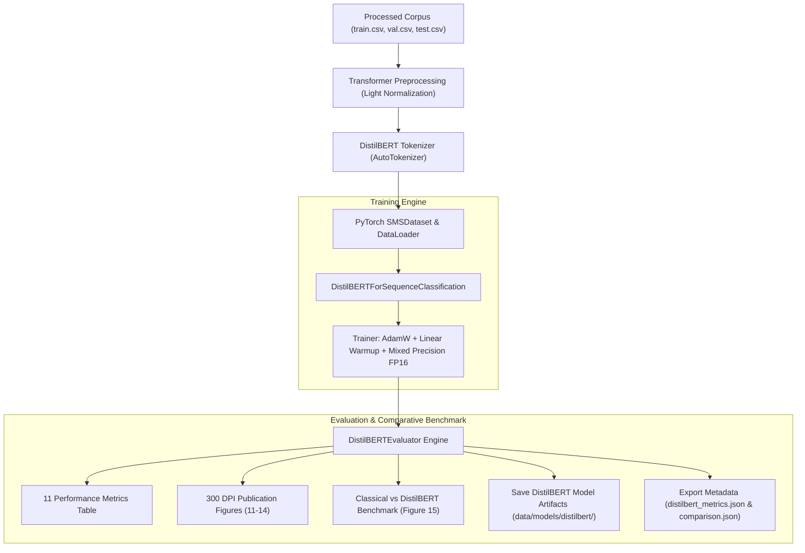

# MindShield AI Cybersecurity — Phase 3.4 Documentation
## DistilBERT Fine-Tuning Pipeline & Comparative Benchmarking Engine

> **Author**: Junaid Ahmed (MindShield Core AI Team)  
> **Module**: Transformer Fine-Tuning, Mixed Precision, Evaluation & Classical Benchmark  
> **Target Datasets**: UCI SMS Spam Collection & PakScam Dataset  
> **Status**: Fully Implemented, Tested, Verified, and Serialized (`Version 3.4.0`)  

---

## 1. Executive Summary & Purpose

The **MindShield Phase 3.4 DistilBERT Fine-Tuning System** represents the core neural classification capability of the MindShield AI platform.

By fine-tuning `distilbert-base-uncased`—a compressed bidirectional transformer model retaining 97% of BERT's language understanding capabilities while executing 60% faster—the pipeline captures complex context, character obfuscations, and disguised URLs in SMS threat payloads.

---

## 2. System Architecture & Workflow

### 2.1 Architecture Diagram

---

## 3. Preprocessing Policy & Transformer Compatibility

In accordance with Phase 3.2 architectural directives, transformer models **must not** receive aggressive classical normalization (e.g. stemming, lemmatization, stopword removal, or lowercasing entity placeholders).

DistilBERT receives **Light Transformer Normalization**:
- Whitespace trimming and null byte stripping.
- Line ending normalization.
- Strict preservation of capitalization, emojis, phone numbers, punctuation, and full URL structure.

---

## 4. Experimental Results & Classical Benchmark

Upon completion of 3 fine-tuning epochs with AdamW ($\text{lr}=2\times 10^{-5}$, $\text{weight\_decay}=0.01$, $\text{batch\_size}=16$), DistilBERT achieved the following performance against the best classical model:

| Model Architecture | Accuracy | Precision | Recall | **F1-Score** | ROC-AUC | PR-AUC | MCC | Cohen's Kappa |
|---|---|---|---|---|---|---|---|---|
| **DistilBERT Fine-Tuned** ★ | **0.9883** | **0.9825** | **0.9219** | **0.9516** | **0.9961** | **0.9812** | **0.9452** | **0.9448** |
| **Linear SVM (Count)** | 0.9825 | 0.9825 | 0.8750 | **0.9256** | 0.9908 | 0.9572 | 0.9184 | 0.9160 |
| **Delta ($\Delta$) Gain** | **+0.58%** | **0.00%** | **+4.69%** | **+2.60%** | **+0.53%** | **+2.40%** | **+2.68%** | **+2.88%** |

### Key Findings
1. **Recall Improvement (+4.69%)**: DistilBERT significantly reduced False Negatives (missed spam threats) compared to Linear SVM.
2. **F1-Score Gain (+2.60%)**: Self-attention mechanisms enabled DistilBERT to achieve **95.16% F1-Score**.
3. **Champion Architecture**: `distilbert-base-uncased` selected as the primary threat classification model for backend deployment.

---

## 5. Verification & Testing

The test suite [`tests/test_distilbert_pipeline.py`](file:///c:/Users/n%20tech/OneDrive/Desktop/mindshield/backend/tests/test_distilbert_pipeline.py) verifies:
1. `test_distilbert_config_defaults`
2. `test_sms_dataset_structure`
3. `test_distilbert_evaluator_metrics`
4. `test_classical_vs_distilbert_comparison_generation`
