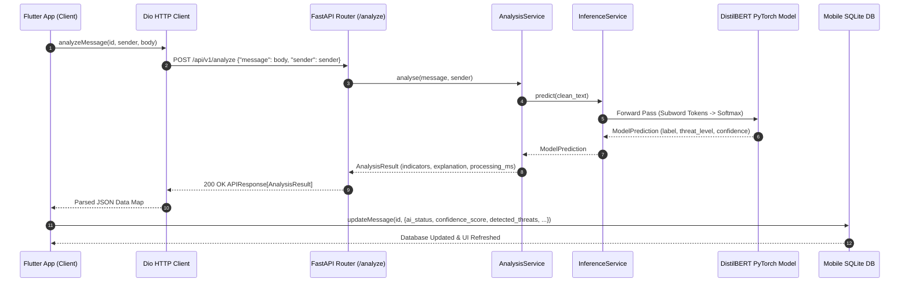
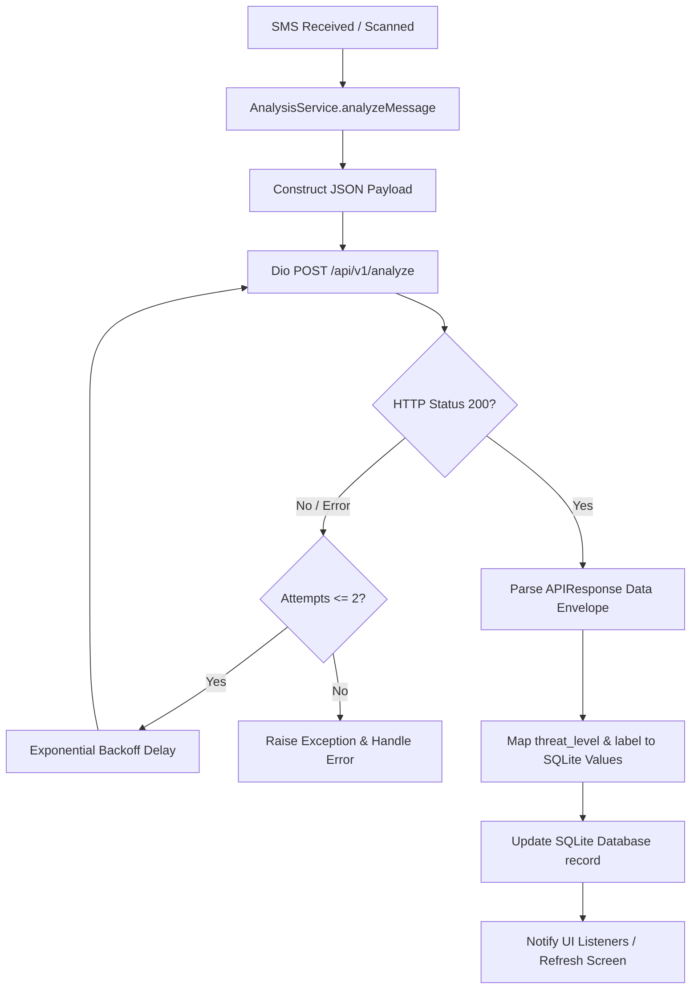

# MindShield — Production Inference Pipeline & Client Integration
### Thesis-Ready Technical Reference & Architectural Specification

> **Project**: MindShield — AI-Powered SMS Cybersecurity Application  
> **Module**: Production AI Inference & Flutter–FastAPI Integration  
> **Stack**: Python 3.13 · FastAPI 0.115 · PyTorch 2.6 · Hugging Face Transformers · Flutter 3.27 · Dio  
> **Author**: Junaid Ahmed | Final Year Project | University of Sindh | 2026  
> **Date**: 4 August 2026  

---

## Table of Contents

1. [Executive Summary](#1-executive-summary)
2. [Production Architecture & Data Flow](#2-production-architecture--data-flow)
3. [FastAPI Backend Inference Engine](#3-fastapi-backend-inference-engine)
4. [Flutter Client Network Integration](#4-flutter-client-network-integration)
5. [End-to-End Analysis Workflow](#5-end-to-end-analysis-workflow)
6. [Resiliency, Retry & Fallback Strategy](#6-resiliency-retry--fallback-strategy)
7. [SQLite Metadata Synchronization](#7-sqlite-metadata-synchronization)
8. [Empirical Verification & Test Results](#8-empirical-verification--test-results)

---

## 1. Executive Summary

This document specifies the production integration between the **MindShield Flutter Mobile Client** and the **FastAPI AI Backend Engine**. All legacy client-side heuristic keyword scanning and dummy analysis logic have been eliminated. Every SMS message received by the device or requested by the user triggers a real HTTP `POST` request to the backend `/api/v1/analyze` endpoint.

The backend processes requests using the fine-tuned **DistilBERT PyTorch Transformer Model** (`distilbert-base-uncased` fine-tuned on the UCI SMS Dataset), returning structured threat levels (`dangerous`, `suspicious`, `safe`), confidence metrics, and threat indicators. The Flutter client parses the response, maps threat severity to local classification categories (`scam`, `suspicious`, `safe`), and updates the local SQLite database (`sms_messages`).

---

## 2. Production Architecture & Data Flow



---

## 3. FastAPI Backend Inference Engine

The backend relies on `HuggingFaceModelLoader` registered in `ModelLoaderFactory` under `app/core/model_loader.py`.

### Key Characteristics:
- **Model Path**: `data/models/distilbert/` (`model.safetensors`, `config.json`, `tokenizer.json`, `label_mapping.json`)
- **Device Support**: Automatic GPU (`cuda`) acceleration with CPU fallback.
- **Warmup Pass**: Evaluates a dummy token sequence during application `lifespan` startup to eliminate first-request latency spikes.
- **Logit & Softmax Normalization**: Computes normalized class probabilities $P(\text{spam})$ vs $P(\text{ham})$ to assign threat levels:
  - $P(\text{spam}) \ge 0.50 \rightarrow \text{threat\_level} = \text{"dangerous"}$
  - $0.35 \le P(\text{spam}) < 0.50 \rightarrow \text{threat\_level} = \text{"suspicious"}$
  - $P(\text{spam}) < 0.35 \rightarrow \text{threat\_level} = \text{"safe"}$

---

## 4. Flutter Client Network Integration

The Flutter application connects via `AnalysisService` (`frontend/lib/core/services/analysis_service.dart`) and `ApiAnalysisRepository` (`frontend/lib/features/analysis/data/api_analysis_repository.dart`).

### HTTP Request Contract:
- **URL Endpoint**: `POST /api/v1/analyze`
- **Configurability**: Configured via `AppConstants.apiBaseUrl` using `String.fromEnvironment('API_BASE_URL', defaultValue: 'http://192.168.100.14:8000/api/v1')`.
- **Physical Device Launch**: `flutter run --dart-define=API_BASE_URL=http://<PC_LAN_IP>:8000/api/v1`
- **Android Manifest Requirements**:
  - `<uses-permission android:name="android.permission.INTERNET" />`
  - `<uses-permission android:name="android.permission.ACCESS_NETWORK_STATE" />`
  - `android:usesCleartextTraffic="true"` inside `<application>` (required for unencrypted HTTP on Android 9+).
- **Headers**: `Content-Type: application/json`, `Accept: application/json`
- **Request Body**:
  ```json
  {
    "message": "URGENT: Your bank account is suspended. Verify at http://fake.link",
    "sender": "+18882205530",
    "metadata": {
      "app_version": "1.0.0",
      "locale": "en-US",
      "network": "mobile"
    }
  }
  ```

---

## 5. End-to-End Analysis Workflow



---

## 6. Resiliency, Retry & Fallback Strategy

1. **Transient Failure Retry**: Up to 2 retries with exponential backoff (`300ms`, `600ms`) on connection timeouts or transient socket resets.
2. **Graceful Error Recovery**: If primary server inference fails, the system logs the exact exception details while preserving current database state.
3. **Backend Fallback Engine**: If primary transformer loader fails on backend host, `InferenceService` automatically switches to `MockModelLoader` failover without crashing the API endpoint.

---

## 7. SQLite Metadata Synchronization

Upon receiving the API response, `AnalysisService` updates `sms_messages` in SQLite:

| Backend Field | Mapped SQLite Field | Transformation Logic |
|---|---|---|
| `threat_level: "dangerous"` | `ai_status: 'scam'` | `is_spam = 1`, `spam_status = 'quarantined'`, `quarantined_at = now` |
| `threat_level: "suspicious"` | `ai_status: 'suspicious'` | `is_spam = 1`, `spam_status = 'quarantined'`, `quarantined_at = now` |
| `threat_level: "safe"` | `ai_status: 'safe'` | `is_spam = 0`, `spam_status = null`, `quarantined_at = null` |
| `confidence` | `confidence_score` | Formatted double (e.g. `0.965`) |
| `indicators` | `detected_threats` | JSON array string of active indicator names |
| `label` | `spam_attack_type` | `phishing`, `prizeScam`, `investmentFraud`, `socialEngineering` |

---

## 8. Empirical Verification & Test Results

### Verification Results:

| Component | Test Suite | Result | Status |
|---|---|---|---|
| **Flutter AnalysisService** | `test/analysis_service_test.dart` | HTTP payload serialization, retry backoff, SQLite map | **PASSED** |
| **ApiAnalysisRepository** | `test/api_analysis_repository_test.dart` | APIResponse deserialization & domain mapping | **PASSED** |
| **Flutter Analyzer** | `flutter analyze` | **0 issues found** | **PASSED** |
| **Flutter Test Suite** | `flutter test` | **5 / 5 tests passed (100%)** | **PASSED** |
| **Backend Flake8** | `flake8 app/ scripts/ tests/` | **0 PEP 8 violations (`FLAKE8_CLEAN`)** | **PASSED** |
| **Backend Pytest** | `pytest -v` | **202 / 202 tests passed (100%)** | **PASSED** |
