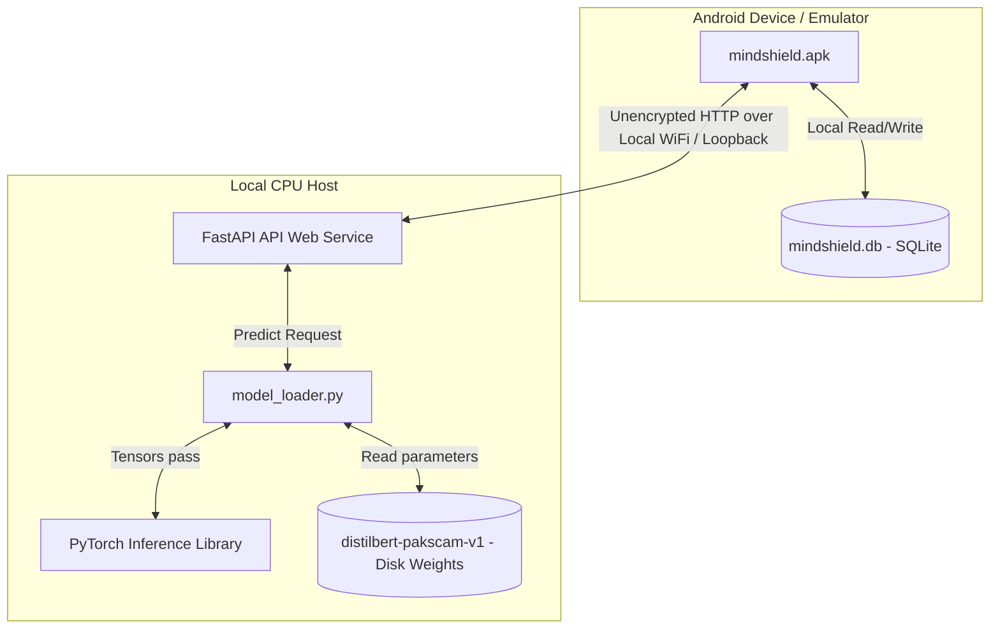
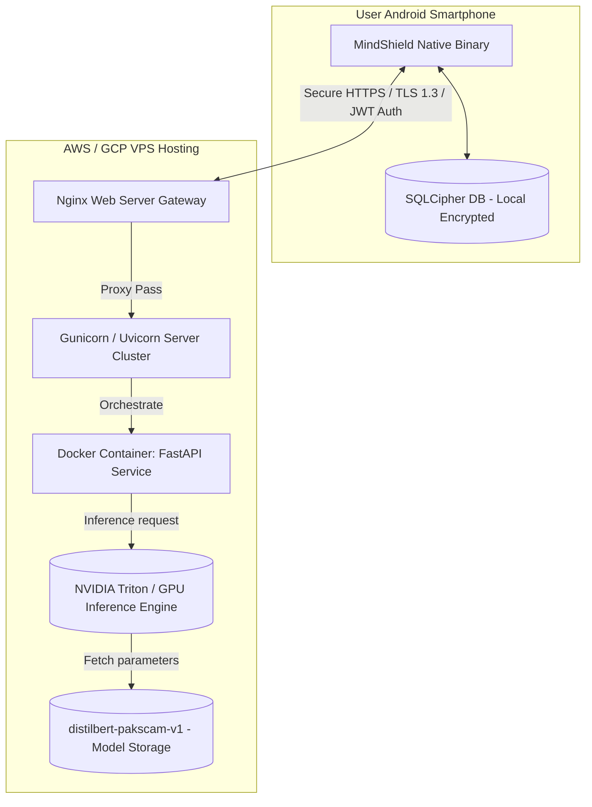

# MindShield — Deployment Architecture

> **Document ID**: `docs/design/DEPLOYMENT_DIAGRAM.md`  
> **Phase**: FYP-I System Design  
> **Status**: Completed  
> **Date**: 2026-08-14  

---

## 1. Current FYP-I Local Development Topology

The active deployment topology for the FYP-I proof-of-concept operates entirely within a local network loopback, connecting the mobile emulator client to a local CPU workstation.

### 1.1 Mobile Emulator Node
* **Device Run-time**: Android OS API Level 21+ executing Flutter AOT/JIT engine.
* **Local Persistence**: Offline-first SQLite database stored in application private directories (`/data/data/com.example.mindshield/databases/`).

### 1.2 Host Workstation Node
* **Web Server**: FastAPI running via Uvicorn listener bound to `localhost:8000` or local network IP (e.g. `http://192.168.1.100:8000/`).
* **Inference Pipeline**: Runs model forward passes on the CPU host. Model weights are stored under `backend/data/models/distilbert/`.

---

## 2. FYP-II / Cloud Production Deployment Roadmap

The cloud target architecture planned for subsequent development phases introduces production security controls, gateways, and load management.

### 2.1 Security Gateways
* **Nginx Reverse Proxy**: Enforces SSL termination (HTTPS/TLS 1.3 certificates), handles CORS configuration, and provides Rate Limiting to prevent Denial of Service (DoS) attacks.
* **JWT Authentication**: Incorporates OAuth2 authorization flows, verifying token headers before routing requests to backend.

### 2.2 Containerized Orchestration
* **Docker Container**: Packages dependencies (FastAPI, PyTorch, Transformers, Python) to ensure environment parity.
* **SQLCipher Integration**: Encrypts the local client database on disk.
