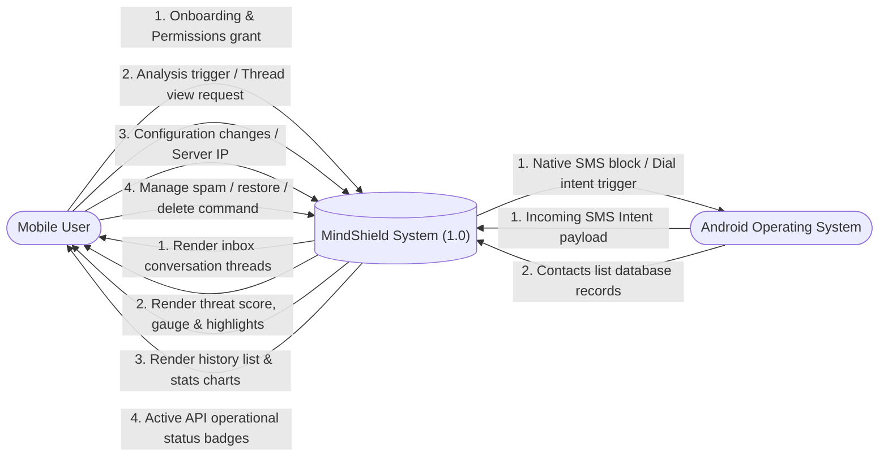

# MindShield — Data Flow Diagram (DFD Level 0)

> **Document ID**: `docs/design/DFD_LEVEL_0.md`  
> **Phase**: FYP-I System Design  
> **Status**: Completed  
> **Date**: 2026-08-14  

---

## 1. DFD Level 0 (Context Diagram)

The Context Diagram defines the boundary of the MindShield application, modeling all data exchanges between the core system and external entities.

---

## 2. Interface Flow Specifications

### 2.1 Inputs
1. **SMS Intent Payload**: Incoming raw text stream (body, sender address, timestamp) routed from the Android broadcast receiver.
2. **Onboarding / Permission Grant**: Android OS security allowances (`READ_SMS`, `RECEIVE_SMS`) approved by the user.
3. **Trigger Commands**: Manual selections prompting API analysis, spam management, settings changes, or navigation.

### 2.2 Processes
* **MindShield System**: Encapsulates on-device SQLite caching, background method channel handlers, REST requests compilation, text validation routines, and the DistilBERT inference pipeline.

### 2.3 Outputs
1. **Inbox Visualisation**: Grouped conversation lists.
2. **Threat Assessment**: Scores, safety categories (safe, suspicious, dangerous), and heuristic term warnings.
3. **System Logs & Dashboard metrics**: Cached logging views and aggregated charts.
4. **Android Intent Triggers**: Opens native dialer and SMS client parameters.
