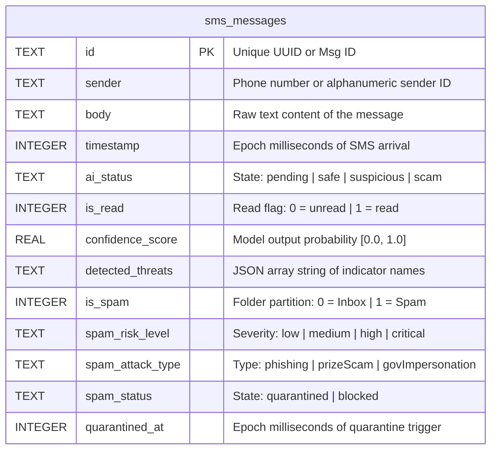

# MindShield — Database ERD & Schema

> **Document ID**: `docs/design/ERD.md`  
> **Phase**: FYP-I System Design  
> **Status**: Completed  
> **Date**: 2026-08-14  

---

## 1. Entity Relationship Diagram (UML ER Notation)

The local mobile persistence database (`mindshield.db`) implements a consolidated single-table storage strategy to maximize offline-first efficiency. 

---

## 2. SQLite Schema Specification

### 2.1 Table: `sms_messages`
Defined and maintained inside [`database_helper.dart`](file:///c:/Users/n%20tech/OneDrive/Desktop/mindshield/frontend/lib/core/database/database_helper.dart).

| Field Name | SQLite Type | Constraints | Description |
|---|---|---|---|
| `id` | `TEXT` | `PRIMARY KEY` | Unique ID generated or extracted from OS telephony. |
| `sender` | `TEXT` | `NOT NULL` | Phone number (e.g. `+923001234567`) or Alphanumeric ID (e.g. `HBL`). |
| `body` | `TEXT` | `NOT NULL` | Raw SMS content text body. |
| `timestamp` | `INTEGER` | `NOT NULL` | Device timestamp when SMS was received (Epoch ms). |
| `ai_status` | `TEXT` | `NOT NULL` | Current analysis state: `pending`, `safe`, `suspicious`, `scam`. |
| `is_read` | `INTEGER` | `NOT NULL DEFAULT 0` | Render marker. `0` represents unread, `1` represents read. |
| `confidence_score` | `REAL` | `NULLABLE` | Probability score returned from model inference. |
| `detected_threats` | `TEXT` | `NOT NULL` | Stores JSON array string (e.g., `["phishing", "malicious_url"]`). |
| `is_spam` | `INTEGER` | `NOT NULL DEFAULT 0` | Routing flag. `0` routes to Inbox screen; `1` routes to Spam. |
| `spam_risk_level`| `TEXT` | `NULLABLE` | Categorized threat severity: `low`, `medium`, `high`, `critical`. |
| `spam_attack_type`| `TEXT` | `NULLABLE` | Localized attack type (e.g., `prizeScam`, `govImpersonation`). |
| `spam_status` | `TEXT` | `NULLABLE` | Management state: `quarantined` or `blocked`. |
| `quarantined_at` | `INTEGER` | `NULLABLE` | Timestamp when thread was moved to spam folder (Epoch ms). |

---

## 3. Key Design Decisions

### 3.1 Consolidated Schema (Single Table)
Instead of creating separate tables for conversations, spam, and log histories, MindShield records everything inside `sms_messages`. This provides several benefits:
* **High Performance**: Eliminates the overhead of complex JOIN queries, keeping transaction latencies under $15\text{ ms}$.
* **Data Integrity**: Eliminates the risk of orphaned foreign keys when messages are deleted or moved.
* **Flexible Queries**: Views are dynamically compiled via query filters:
  * *Inbox View*: Queries `is_spam = 0` and groups by sender.
  * *Spam View*: Queries `is_spam = 1` and groups by sender.
  * *History Log View*: Queries `ai_status != 'pending'`.

### 3.2 Non-Relational Storages
* **Settings**: User settings (API server endpoints and preferences) are stored in `SharedPreferences` (XML key-value store in Android) rather than SQLite, ensuring that startup IP loading is fast and independent of database initialization.
