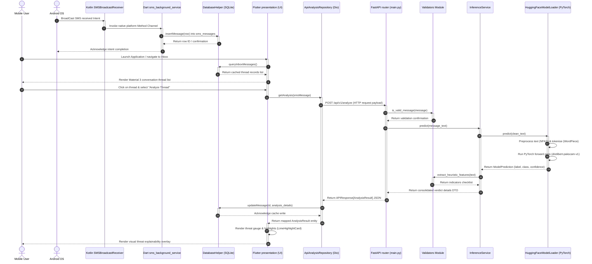

# MindShield — System Sequence Workflow

> **Document ID**: `docs/design/SEQUENCE_DIAGRAM.md`  
> **Phase**: FYP-I System Design  
> **Status**: Completed  
> **Date**: 2026-08-14  

---

## 1. End-to-End SMS Interception & Threat Analysis Workflow

This sequence diagram details the chronological execution path across the mobile client, native method channels, SQLite persistence, FastAPI backend, and PyTorch inference pipeline.

---

## 2. Step-by-Step Execution Narrative

### Phase A: Background Message Acquisition (Steps 1–6)
* The Android OS triggers a receiver intent when an SMS arrives.
* The Kotlin wrapper intercepts the intent payload and sends it via platform channels to the background Dart task.
* The background service writes the raw text and sender info to `sms_messages` in SQLite, creating a new thread or adding to an existing one.

### Phase B: UI Navigation & View Assembly (Steps 7–10)
* The user opens the app, prompting the inbox list view.
* The client queries SQLite for safe/inbox messages and displays the grouped list.

### Phase C: Deep-Learning Inference & Highlight Visualisation (Steps 11–24)
* The user opens a thread and triggers analysis.
* The Dio client posts the raw text and sender metadata over HTTP to the backend server.
* The FastAPI server parses the request using Pydantic and executes basic validations.
* The validator outputs validation confirmations, forwarding the payload to the active inference manager.
* The PyTorch model tokenizer processes the text and runs forward inference on the production model (`distilbert-pakscam-v1`).
* Heuristic indicators are evaluated to identify matches (such as shortened URLs).
* The combined results are wrapped in a standard JSON response envelope and returned.
* The client caches these metrics locally in SQLite, maps the JSON payload to domain entities, and renders the visual explanation overlays using `LimeHighlightCard`.
