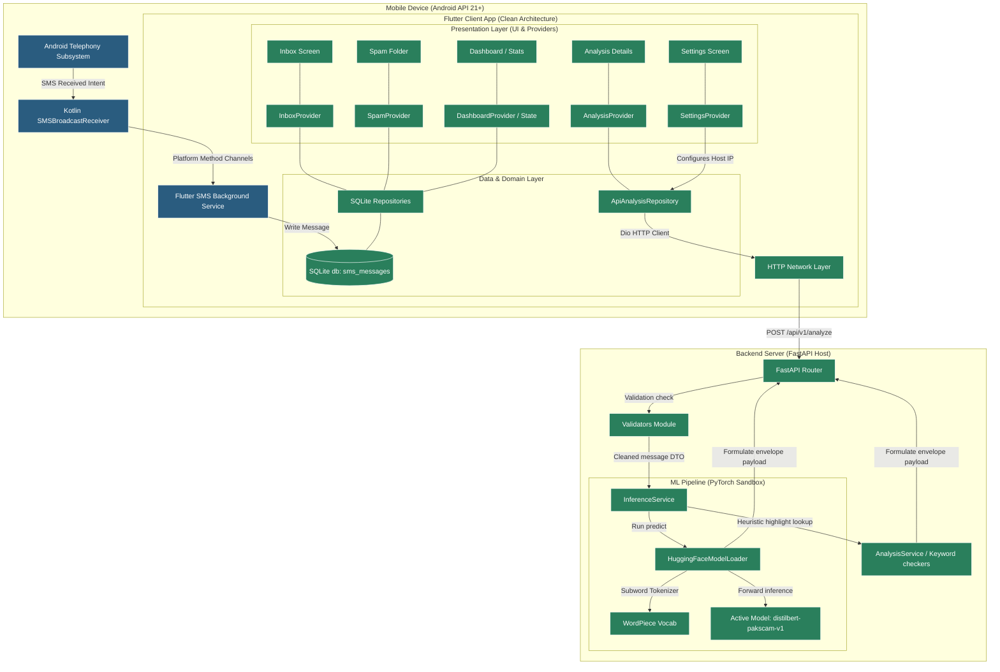

# MindShield — System Architecture

> **Document ID**: `docs/design/SYSTEM_ARCHITECTURE.md`  
> **Phase**: FYP-I System Design  
> **Status**: Completed  
> **Date**: 2026-08-14  

---

## 1. High-Level Blueprint

The system architecture of MindShield implements a clean, decoupled layout dividing the local mobile client (built in Flutter and native Android/Kotlin bindings) and the centralized deep learning backend server (built in FastAPI and PyTorch).

---

## 2. Layer Descriptions

### 2.1 Android / Kotlin Native Layer
* **Kotlin Broadcast Receiver**: Intercepts incoming SMS intents at OS level.
* **Method Channel Binder**: Directs raw SMS properties into the background Dart engine.

### 2.2 Flutter Client Layers
* **Presentation (UI)**: Material 3 visual cards displaying threat gauges, visual explanation highlights, settings configuration, history log cards, and dashboard metrics.
* **State Management (Providers)**: ChangeNotifier logic driving reactive data flows (e.g. updating inbox list when SQLite triggers update notifications).
* **Domain Layer**: Core models (`SmsMessage`, `Conversation`, `AnalysisResult`).
* **Data Layer**: Repositories converting API JSON schemas or SQLite row queries into clean domain models.

### 2.3 FastAPI Backend Layers
* **Router & Controller**: Parsers checking payload structures via Pydantic schemas.
* **Validation Sub-module**: Pure Python regex validators scrubbing inputs and verifying formatting constraints.
* **Inference Service**: Handles model lifetime status queries, execution profiling, and handles weight load failures by reverting to heuristics.

### 2.4 ML Model Layer
* **WordPiece Tokenizer**: Maps text to subword vocab keys, matching the training configuration of 128 tokens.
* **DistilBERT Classification Engine**: Primary model (**`distilbert-pakscam-v1`**) loaded in PyTorch, executing logits forward passes.

---

## 3. Strict Boundary Architecture Controls

To ensure design accuracy, the following architectural elements are **EXCLUDED** from the current system blueprint and marked strictly as **FYP-II/Planned**:
* **HTTPS Protocol**: Current prototype communicates over unencrypted local HTTP. HTTPS is restricted to the cloud production roadmap.
* **True Local Inference**: The model is hosted in the Python FastAPI backend, not locally on the device (ONNX/TFLite is planned).
* **Multilingual Classification (XLM-RoBERTa)**: Active weights are English/Transliterated DistilBERT (`v1`). Multi-model pipeline routing is planned.
