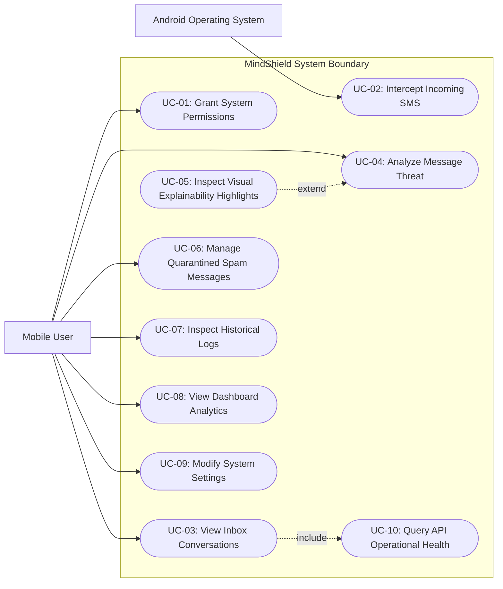

# MindShield — Use Case Specifications

> **Document ID**: `docs/design/USE_CASE_DIAGRAM.md`  
> **Phase**: FYP-I System Design  
> **Status**: Completed  
> **Date**: 2026-08-14  

---

## 1. UML Use Case Diagram

The following diagram defines the interactions between human/system actors and the MindShield application boundary.

---

## 2. Detailed Use Case Descriptions

### UC-01 — Grant System Permissions
* **Actor**: Mobile User
* **Goal**: Enable background and storage accesses.
* **Flow**: User clicks "Grant Permissions" button; Android prompts native pop-ups; user selects "Allow".
* **System Action**: Registers permission flags in State and enables Kotlin receivers.

### UC-02 — Intercept Incoming SMS
* **Actor**: Android OS (System Trigger)
* **Goal**: Process incoming SMS automatically.
* **Flow**: OS receives SMS; dispatches broadcast intent; Kotlin catcher intercepts; routes details to Flutter; written to local SQLite storage.
* **System Action**: Thread updates dynamically.

### UC-03 — View Inbox Conversations
* **Actor**: Mobile User
* **Goal**: View SMS grouped threads.
* **Flow**: User opens main app interface.
* **System Action**: Queries local database filtering `is_spam = 0` and groups by sender.

### UC-04 — Analyze Message Threat
* **Actor**: Mobile User
* **Goal**: Retrieve deep-learning threat verdict for selected text.
* **Flow**: User opens thread; clicks "Analyze Thread"; client queries FastAPI REST service.
* **System Action**: API returns confidence score, labels, and heuristic highlights.

### UC-05 — Inspect Visual Explainability Highlights
* **Actor**: Mobile User
* **Goal**: Audit classification rationale (extends UC-04).
* **Flow**: Triggered automatically when threat verdict is displayed.
* **System Action**: Extracts active indicators and overlays color highlights on suspicious terms (e.g. prize codes, shortlinks).

### UC-06 — Manage Quarantined Spam Messages
* **Actor**: Mobile User
* **Goal**: View, restore, delete, or block messages.
* **Flow**: User navigates to Spam Folder; views message threads (`is_spam = 1`); selects native action (Restore/Delete/Block).
* **System Action**: Invokes local SQLite repositories and Kotlin SMS dialers where required.

### UC-07 — Inspect Historical Logs
* **Actor**: Mobile User
* **Goal**: Review previous threat queries.
* **Flow**: User clicks History Tab; logs load from local cache.
* **System Action**: UI displays a chronological list of analyzed SMS.

### UC-08 — View Dashboard Analytics
* **Actor**: Mobile User
* **Goal**: Inspect security metrics.
* **Flow**: User clicks Dashboard Tab; UI fetches aggregated threat counts.
* **System Action**: Renders safe, suspicious, and dangerous pie charts.

### UC-09 — Modify System Settings
* **Actor**: Mobile User
* **Goal**: Configure API servers or options.
* **Flow**: User navigates to Settings Screen; updates host URL; clicks save.
* **System Action**: App saves values in `SharedPreferences` and re-allocates Dio Client configurations.

### UC-10 — Query API Operational Health
* **Actor**: Flutter Application (System Trigger)
* **Goal**: Check backend/AI state (included by UC-03).
* **Flow**: App launches; calls GET `/health` endpoint asynchronously.
* **System Action**: Renders AI model version status badge in UI header.
